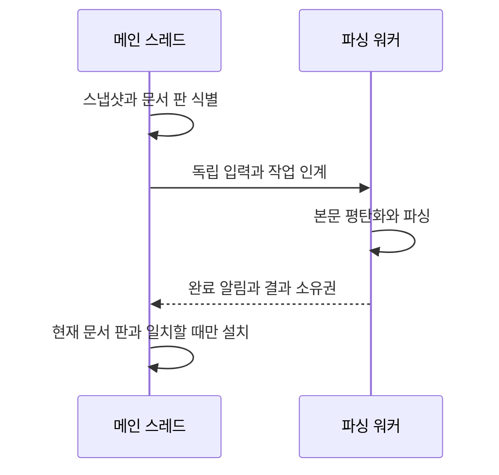
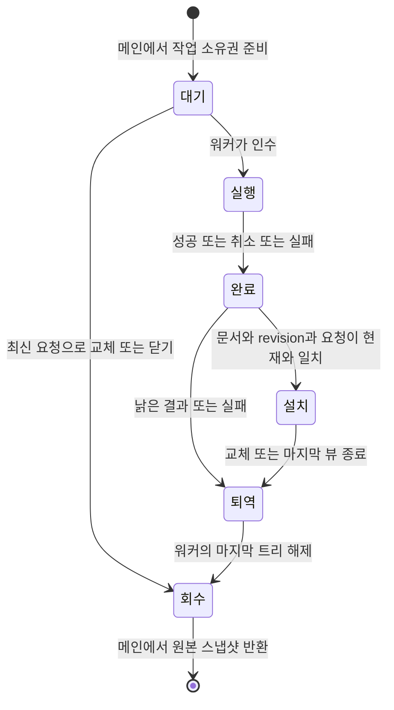

# 구문 파싱 비동기화 검토안

상태: **설계 검토 중, 제품 적용 미승인**. 현재 메인 스레드의 점진 파싱 정책은 유지한다.

## 문제와 근거

PR #4610의 고정 fixture 실측에서 4ms 예산의 C 파싱 호출이 최대 35.347ms까지 관측됐다.
예산은 협력적 중단 요청이며 강제 실행 시간 상한이 아니다. 이 수치는 GUI 입력 지연 실측이 아니다.
입력·IME 응답을 파싱 호출 시간에서 분리할 방법을 검토한다. 파싱 자체의 총시간 단축을 보장하는 안은 아니다.

`src/session/editor/edit_doc.zig`의 `EditableFile.snapshot()`은 이미 persistent rope의 읽기 전용 판을
O(1)로 붙든다. 따라서 스냅샷 부재는 현재 워커를 배제할 근거가 아니다. 다만 `Snapshot.copyRange()`는
별도 바이트 배열을 할당·복사하며, 원본 rope의 마지막 참조 해제에는 그 rope의 allocator가 쓰인다.
참조 계수가 atomic이라는 사실만으로 allocator까지 동시 사용해도 되는 것은 아니다.

## 제안하는 경계

본문 편집·Undo·선택·IME·문서 registry는 메인 스레드가 소유한다. 워커는 소유권이 분리된 입력과
파서만 사용하고 문서나 뷰 포인터를 받지 않는다. `Registry`의 lease는 수명 보장이지 동시 읽기 허가가 아니다.

첫 구현 후보는 한 워커와 문서별 최신 대기 요청이다. 키 입력마다 스레드를 생성하지 않는다.
실행 중인 작업은 협력적으로 취소하고, 취소가 늦어져도 결과 수락 조건으로 낡은 결과를 차단한다.
취소 플래그나 파서 콜백의 저장소는 파싱 호출이 끝날 때까지 유지한다. 활성 문서 우선순위와 문서 간
공정성은 검증 대상이며, 문서별 대기 하나가 전체 메모리의 고정 상한이라는 뜻은 아니다.

작업 식별자는 문서 identity(owner·slot·generation), 본문 revision, 언어/grammar 설정 세대,
요청 serial을 포함한다. 닫기·재열기, 같은 경로의 독립 문서, 언어 변경을 경로 문자열로 판정하지 않는다.
결과 설치는 메인 스레드에서 현재 요청과 일치할 때만 한다. 완료 알림은 기존 저장 wake처럼 합쳐서
메인 큐를 깨우되 저장 큐와 소유권은 공유하지 않는다. 렌더 tick을 완료 전달의 필수 조건으로 두지 않는다.

Tree-sitter의 같은 `TSParser`나 같은 `TSTree` 핸들을 메인과 워커가 동시에 사용하지 않는다.
`Provider.copyReady()`는 트리 복사뿐 아니라 파서 생성과 summary 복사도 하므로 전체 비용을 측정한다.
입력 변경 범위를 안전하게 이어 붙일 수 없는 작업은 해당 스냅샷을 처음부터 파싱한다.
결과 설치 후 highlight·bracket·fold·symbol 캐시는 같은 본문 판으로 다시 검증한다.

## 소유권과 해제에서 먼저 확인할 것

- 원본 스냅샷은 메인에서 마지막 해제를 수행하는 후보를 우선 검토한다. 워커는 원본 allocator로
  할당·해제하지 않고, 별도의 바이트 배열과 파서 상태를 소유한다. 스냅샷 반환을 누락하면 누수가 되므로
  성공·실패·취소·종료 모두 소유권을 회수하는 경로가 필요하다.
- 워커의 평탄화 배열과 완료 결과에는 수명이 명확한 allocator를 사용한다. 메인에서 설치·퇴역하는
  결과의 allocator가 그 사용 스레드를 허용하는지 확인한다. 단순히 page allocator로 모든 제품 할당을 바꾸지 않는다.
- 낡은 결과와 이전 트리의 마지막 해제 비용도 측정한다. 파싱만 워커로 옮기고 큰 트리를 메인에서
  해제하면 긴 메인 작업이 남을 수 있다. 퇴역 큐는 비용과 소유권 검증 후 결정한다.
- 종료 시 워커가 UI 콜백을 기다리는 동안 메인이 join하는 구조를 금지한다. 전역 종료·문서 닫기와
  알림 전달을 분리하고, 완료 알림이 닫힌 창이나 session을 직접 참조하지 않게 한다.

## 적용 전 정책 논의

권장 후보는 입력과 IME를 계속 받고, 최신 파싱이 준비될 때까지 기존 pending 계약을 유지하는 것이다.
위치가 낡은 트리를 현재 본문의 bracket 점프·접힘·심볼 판단에 사용하지 않는다. 기존 pending 표시와
조회 거절 규칙을 조사한 뒤 소비처별 동작을 명시한다. OOM 때 메인 동기 파싱으로 몰래 돌아가지 않는다.
작업 준비 실패 시 본문·Undo를 보존하고 파싱을 pending으로 유지할지, 비활성 상태와 알림을 제공할지는
사용자 논의가 필요하다. 새 메모리 상한이나 문서 크기 제한도 이 검토만으로 도입하지 않는다.

## 검증과 판정 기준

다음은 아직 실행 결과가 아닌, 구현 전 측정·실패 주입 계획이다.

| 공격 조건 | 확인할 불변식 | 정상 대조군 |
| --- | --- | --- |
| A 작업 뒤 B 편집, B보다 늦은 A 완료 | A가 현재 트리·input stamp·캐시를 교체하지 않음 | 현재 B 완료는 설치 |
| 닫고 같은 slot/경로로 재열기 | generation이 다른 문서에 결과가 붙지 않음 | 원래 문서가 살아 있으면 설치 |
| 큐 준비·평탄화·결과 준비 할당 실패 | 본문·선택·Undo 보존, 누수·동기 파싱 우회 없음 | 동일 입력의 할당 성공 |
| 취소 지연·언어 변경·종료 중 완료 | 살아 있는 취소 저장소, 설정 세대 검사, 종료 교착 없음 | 취소 없는 최신 언어 결과 |
| 공유 뷰·멀티커서·IME 조합 중 연속 편집 | 문서 판과 모든 소비처가 일치, 옛 offset 재사용 없음 | 같은 확정 본문의 독립 cold parse |

기존 다섯 fixture를 같은 해시·빌드 설정으로 사용해 스냅샷 retain, 평탄화, `Provider.copyReady`,
메인 설치, 트리/스냅샷 마지막 해제를 따로 측정한다. 전체 완료 시간·메인 점유·peak 메모리·취소 작업량을
함께 기록한다. GUI 입력 지연은 전면 앱 실측으로 별도 확인하며 함수 실행 시간을 그 대용으로 쓰지 않는다.
연속 편집에서 대기 요청이 교체되는지와 여러 문서에서 작업이 굶지 않는지도 확인한다.

## 독립 인계 실측 결과

[스냅샷·트리 인계 실측](../../tools/editor-async-parse-measure/results.md)은 다섯 고정 원문에서
15프로세스·300표본을 수집했다. 3,127,780byte 원문에서 Provider 복사 중앙값은 약 0.002ms,
워커 본문 복사는 약 0.248ms였다. 마지막 Provider 해제는 중앙값 19.062ms·최대 30.399ms였다.
파싱만 옮기고 마지막 트리를 메인에서 해제하는 설계는 긴 메인 작업을 남길 수 있으므로,
트리 퇴역과 최종 해제 경계를 함께 검토한다. 제품의 증분 편집마다 이 비용이 난다는 뜻은 아니다.

원문과 스냅샷 byte, 복사 트리와 cold parse의 전체 노드 좌표를 대조했고 다섯 실제 오류 주입을 거절했다.
제품 worker·완료 설치·취소·OOM·IME·peak 메모리와 실제 UI 지연은 아직 검증하지 않았다.
원본 rope allocator는 메인에서만 사용했고, 워커 평탄화는 별도 allocator를 사용한 실험이다.

## 단계

1. 현재 스냅샷·파서 복사·해제의 독립 실험과 allocator 경계 조사. 제품 배선 없음.
2. 비용·메모리 결과와 소비처별 pending 동작을 제시하고 기존 점진 정책 변경을 논의.
3. 승인 후 소유권·취소·실패 주입이 가능한 서비스 구현.
4. wake 연결과 실제 IME·공유 뷰 검증 후 제품 경로 전환.

공개 API 근거: [Tree-sitter 동시성 문서](https://tree-sitter.github.io/tree-sitter/using-parsers/3-advanced-parsing.html).
트리 복사 허용은 Maru의 allocator·문서·캐시까지 스레드 안전하다는 보장이 아니다.

## 소비처 조사와 수명 설계 보완

아래 내용은 제품 연결 전 검토안이다. 제품 코드 조사 기준은
`380a6e7942255e3e5fff17b272688070c938f6fd`이며, 실제 동작 변경은 하지 않는다.

### 현재 소비처와 완료 후처리

| 소비처 | 현재 코드에서 확인한 동작 | 비동기 연결 시 보존하거나 결정할 것 |
| --- | --- | --- |
| 구문 색·미니맵 | `syntax.zig`의 `lineColorsInto`가 Provider를 읽는다. 전체 파싱 pending은 트리가 없어 구문 색이 없고, 예산 증분 API는 이동된 이전 트리를 남길 수 있다 | 이전 revision의 offset을 최신 본문에 그대로 쓰지 않는다. 현재 일반 편집이 동기로 끝나는 것과 비동기 pending을 구분한다 |
| 괄호 점프·강조 | `brackets.zig`의 `treeOf`는 pending을 거절한다. 트리를 못 쓰면 최신 본문 `Plain`으로 점프·강조를 계산한다 | 기존 문자 검색을 유지한다. pending을 이유로 점프 자체를 제거하지 않는다 |
| 괄호 색 | `syntax.zig`의 `bracketSource`가 pending·트리 세대·완성된 목록을 검사한다 | 완성되지 않은 괄호 목록을 공개하지 않는다 |
| 구문 선택 확장 | `smart_select.zig`는 pending이면 구문 경로를 쓰지 않는다 | LSP 응답 등 별도 경로의 계약을 보존하고 현재 입력 판을 재검증한다 |
| 접힘 | `mod.zig`의 `promoteFoldRangesToSyntax`는 pending이면 보류한다. LSP가 이미 채웠으면 구문 결과로 덮지 않는다 | 현재 문서·뷰의 줄 축을 검증하고 LSP 우선순위를 유지한다 |
| 심볼 목록 | `advanceSyntax`가 pending이던 프레임에 열린 피커를 재계산한다 | 완료 이벤트에서 열린 피커를 갱신한다. 검색 문자열 변경을 기다리지 않는다 |
| breadcrumb | `syntax.zig`의 `breadcrumb`은 LSP 심볼을 우선하며 pending 자체를 별도 차단하지 않는다 | 기존 증분 API는 offset을 옮긴 이전 트리를 읽을 수 있다. 워커의 수정되지 않은 이전 트리를 대신 노출하면 같은 동작이 아니다 |

`resumeParse`는 입력 증명을 지운다. 완료했다는 bool만으로 현재 본문임을 증명할 수 없으며,
새 input stamp 발급과 소비처 무효화가 함께 필요하다. `advanceSyntax`에 있던 접힘 승격·열린 피커 갱신·
다음 프레임 요청을 완료 이벤트가 대체해야 한다. LSP 응답과 진단의 수명은 별도이며,
구문 트리 완료만으로 그 결과까지 최신으로 판정하지 않는다.

### 작업과 결과의 소유권

- 완료는 성공·취소·실패 모두 소유권을 반환하는 사건이다. 취소 요청은 해제 허가가 아니다.
  실행 중인 parser와 취소 저장소는 실제 C 호출 반환까지 살아 있어야 한다.
- 작업은 문서 pointer 대신 identity·revision·언어 설정 세대·serial과 독립 스냅샷을 가진다.
  메인에서 수락 여부를 판단하며, 워커가 registry나 뷰를 읽지 않는다.
- 완료 연결 노드는 작업 준비 때 확보하는 후보를 검토한다. 완료 시 추가 할당이 실패해 결과나
  원본 스냅샷을 잃는 경로를 만들지 않는다. 실제 intrusive 큐나 고정 슬롯 선택은 구현 전에 검증한다.
- 문서를 닫아도 실행 중인 작업의 반환 경로는 남는다. 닫기 후 같은 slot/경로를 열면 generation이
  달라져 결과가 거절된다. 공유 뷰 하나의 종료와 문서 전체 수명의 종료를 구분한다.
- 메인에서는 현재 판만 설치한다. 최신 요청으로 교체됐거나 언어가 바뀐 결과는 완료 목록에서
  퇴역시킨다. 요청 취소와 결과 수락 검사는 둘 다 필요하다.

### 트리 최종 해제 후보

[워커 해제 실험](../../tools/editor-parse-retirement/README.md)은 메인이 Provider 복사본을 인계한 뒤
원본 참조를 놓고, 워커가 마지막 참조를 해제하는 순서를 실제 API로 확인한다.
이 순서의 성공만으로 제품의 모든 마지막 해제가 워커로 간다고 주장하지 않는다.

제품에서는 공유 뷰·summary·탐색 cursor가 별도 트리 참조를 가질 수 있다. 후보는 워커 서비스가
트리 세대별 보유 참조를 유지하고, 모든 메인 소비처가 그 세대를 반환한 뒤 최종 해제하는 것이다.
메인이 이전 트리를 `ts_tree_edit`로 변경하면 보유 참조가 보호하지 않는 독자 노드가 생길 수 있으므로,
이 후보에서는 메인 소비 트리를 불변으로 두고 편집은 워커의 독립 핸들에서 수행해야 한다.
현재 `onEditSpan` 경로를 그대로 둔 채 뒤에 워커를 덧붙이는 방식으로는 이 조건이 성립하지 않는다.

교체 결과를 설치하기 전에 이전 결과의 반환 저장소도 준비해야 한다. 반환 준비 실패 때 메인에서
큰 트리를 동기 해제하는 우회는 두지 않는다. 본문·Undo는 보존하고 새 결과를 설치하지 않는 후보를
검토하되, 실패 표시와 재시도 정책은 아직 확정하지 않는다.

워커는 메인 반환 확인을 기다리며 전체 작업 처리를 멈추지 않는다. 반환된 세대의 해제를 처리하고
새 요청으로 진행한다. 종료 시에는 메인 소비처가 먼저 참조를 반환한 뒤 워커가 남은 파싱·퇴역을 정리한다.
워커가 메인 callback을 기다리고 메인이 join하는 순환 대기를 만들지 않는다.

### 대기와 메모리

문서별 최신 대기 요청 하나로 키 입력마다 스냅샷을 무제한 쌓는 것을 막는다. 실행 중·설치됨·
반환 대기인 세대는 별개이므로 이 규칙이 메모리 상한이라는 뜻은 아니다. shared subtree도 여러
스냅샷이 있으면 살아남으므로 본문 byte 수의 단순 합으로 실제 사용량을 계산하지 않는다.
반환되지 않는 뷰와 많은 독립 문서의 영향을 측정해야 한다.

단일 워커에서 큰 트리 해제는 다른 문서 파싱을 늦출 수 있다. 메인 점유 감소와 전체 완료 지연을
구분해 측정하고, 해제 전용 스레드 추가는 이 실험만으로 결정하지 않는다.

### 적대적 설계 검토에서 보완한 경계

- 완료 후 트리만 교체하면 열린 심볼 피커와 접힘 승격이 갱신되지 않을 수 있어, 완료 후처리를 명시했다.
- pending에서 모든 괄호 동작을 끄는 초안 해석은 기존 문자 검색 계약을 없애므로 배제했다.
- 메인의 참조 해제만 워커로 보낸다고 끝나지 않는다. shared 뷰·summary의 마지막 참조와 메인 편집의
  독자 노드를 포함해 세대별 반환을 추적해야 한다.
- 닫기 때 작업을 즉시 해제하면 늦은 C 반환이 해제된 저장소에 접근할 수 있어, 취소 요청과 반환을 구분했다.
- 최신 대기 요청 하나를 전체 메모리 상한으로 오인하지 않도록 실행·설치·반환 대기 세대를 분리했다.

이 항목들은 코드 경로 조사와 설계 반례다. 아직 구현하지 않은 제품 서비스의 실행 검증으로 세지 않는다.

## 결과 수락과 반환의 실행 모델

[독립 수명 모델](../../tools/editor-parse-lifecycle/README.md)은 작업 완료와 메인 전달을 분리해
단일 워커의 사건 순서와 문서 닫기 시점을 조합한 72경로를 검사한다. 문서 슬롯 재사용·대기 교체·
트리 없는 실패 완료·중복 전달/퇴역·공유 독자 반환과 정상 수락을 별도로 확인한다.
이것은 제품 작업 큐나 C 파서를 구현한 것이 아니며, 앞선 실제 Provider 실험과 구분한다.

검토안에 추가할 조건은 **작업 준비 성공과 본문 판 갱신을 분리한다**는 것이다. 새 작업 준비에 실패해도
본문은 이미 새 revision일 수 있다. 이전 입력 판을 그대로 ‘현재’로 두면 늦게 온 결과가 수락될 수 있으므로,
준비 실패를 이유로 이전 판 증명을 유지하지 않는다. 모델은 큐가 생기지 않는 사건으로 이를 대조했으며
실제 allocator OOM 주입은 하지 않았다.

모델에서 문서 generation 검사 누락, serial 검사 누락, 준비 실패 시 이전 판 유지,
실행 중 스냅샷 즉시 해제, 공유 독자가 남은 트리 해제의 다섯 결함을 주입하면 검사가 거절한다.
제품의 실제 취소 callback·wake·메모리·락·종료·뷰 참조까지 검증한 결과로 일반화하지 않는다.
