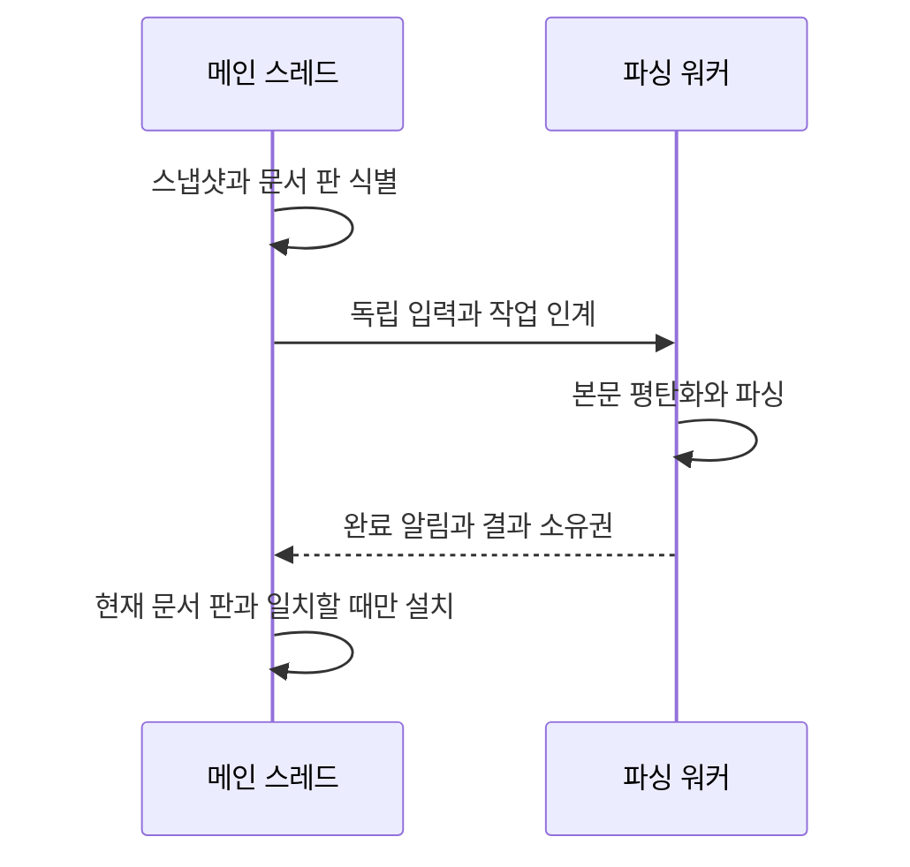
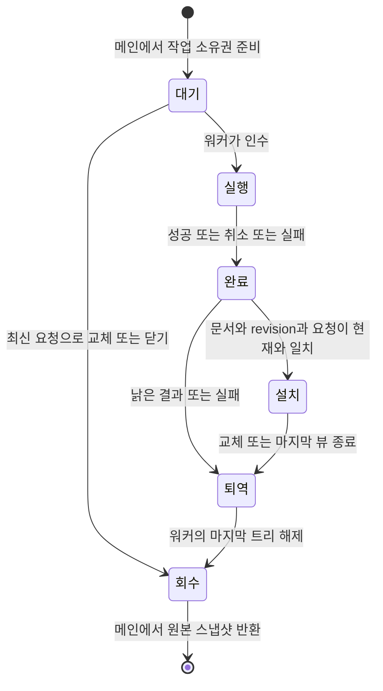

# 구문 파싱 비동기화 검토안

상태: **메인 큐·문서 수명 소유자 구현, 일반 입력·표시 연결 전 검토**. 현재 메인 스레드의 점진 파싱 정책은 유지한다.

## 문제와 근거

PR #4610의 고정 fixture 실측에서 4ms 예산의 C 파싱 호출이 최대 35.347ms까지 관측됐다.
예산은 협력적 중단 요청이며 강제 실행 시간 상한이 아니다. 이 수치는 GUI 입력 지연 실측이 아니다.
입력·IME 응답을 파싱 호출 시간에서 분리할 방법을 검토한다. 파싱 자체의 총시간 단축을 보장하는 안은 아니다.

`src/session/editor/edit_doc.zig`의 `EditableFile.snapshot()`은 이미 persistent rope의 읽기 전용 판을
O(1)로 붙든다. 따라서 스냅샷 부재는 현재 워커를 배제할 근거가 아니다. 다만 `Snapshot.copyRange()`는
별도 바이트 배열을 할당·복사하며, 원본 rope의 마지막 참조 해제에는 그 rope의 allocator가 쓰인다.
참조 계수가 atomic이라는 사실만으로 allocator까지 동시 사용해도 되는 것은 아니다.

## 제안하는 경계

본문 편집·Undo·선택·IME·문서 registry는 메인 스레드가 소유한다. 워커는 소유권이 분리된 입력과
파서만 사용하고 문서나 뷰 포인터를 받지 않는다. `Registry`의 lease는 수명 보장이지 동시 읽기 허가가 아니다.

서비스 기반은 상주 워커 하나와 문서별 최신 대기 요청으로 구현했다. 키 입력마다 스레드를 생성하지 않는다.
실행 중인 작업은 협력적으로 취소하고, 취소가 늦어져도 결과 수락 조건으로 낡은 결과를 차단한다.
취소 플래그나 파서 콜백의 저장소는 파싱 호출이 끝날 때까지 유지한다. 활성 문서 우선순위와 문서 간
공정성은 검증 대상이며, 문서별 대기 하나가 전체 메모리의 고정 상한이라는 뜻은 아니다.

작업 식별자는 문서 identity(owner·slot·generation), 본문 revision, 언어/grammar 설정 세대,
요청 serial을 포함한다. 닫기·재열기, 같은 경로의 독립 문서, 언어 변경을 경로 문자열로 판정하지 않는다.
결과 설치는 메인 스레드에서 현재 요청과 일치할 때만 한다. 완료 알림은 기존 저장 wake처럼 합쳐서
메인 큐를 깨우되 저장 큐와 소유권은 공유하지 않는다. 렌더 tick을 완료 전달의 필수 조건으로 두지 않는다.

Tree-sitter의 같은 `TSParser`나 같은 `TSTree` 핸들을 메인과 워커가 동시에 사용하지 않는다.
`Provider.copyReady()`는 트리 복사뿐 아니라 파서 생성과 summary 복사도 하므로 전체 비용을 측정한다.
입력 변경 범위를 안전하게 이어 붙일 수 없는 작업은 해당 스냅샷을 처음부터 파싱한다.
결과 설치 후 highlight·bracket·fold·symbol 캐시는 같은 본문 판으로 다시 검증한다.

## 소유권과 해제에서 먼저 확인할 것

- 원본 스냅샷은 메인에서 마지막 해제를 수행하는 후보를 우선 검토한다. 워커는 원본 allocator로
  할당·해제하지 않고, 별도의 바이트 배열과 파서 상태를 소유한다. 스냅샷 반환을 누락하면 누수가 되므로
  성공·실패·취소·종료 모두 소유권을 회수하는 경로가 필요하다.
- 워커의 평탄화 배열과 완료 결과에는 수명이 명확한 allocator를 사용한다. 메인에서 설치·퇴역하는
  결과의 allocator가 그 사용 스레드를 허용하는지 확인한다. 단순히 page allocator로 모든 제품 할당을 바꾸지 않는다.
- 낡은 결과와 이전 트리의 마지막 해제 비용도 측정한다. 파싱만 워커로 옮기고 큰 트리를 메인에서
  해제하면 긴 메인 작업이 남을 수 있다. 퇴역 큐는 비용과 소유권 검증 후 결정한다.
- 종료 시 워커가 UI 콜백을 기다리는 동안 메인이 join하는 구조를 금지한다. 전역 종료·문서 닫기와
  알림 전달을 분리하고, 완료 알림이 닫힌 창이나 session을 직접 참조하지 않게 한다.

## 적용 전 정책 논의

권장 후보는 입력과 IME를 계속 받고, 최신 파싱이 준비될 때까지 기존 pending 계약을 유지하는 것이다.
위치가 낡은 트리를 현재 본문의 bracket 점프·접힘·심볼 판단에 사용하지 않는다. 기존 pending 표시와
조회 거절 규칙을 조사한 뒤 소비처별 동작을 명시한다. OOM 때 메인 동기 파싱으로 몰래 돌아가지 않는다.
작업 준비 실패 시 본문·Undo를 보존하고 파싱을 pending으로 유지할지, 비활성 상태와 알림을 제공할지는
사용자 논의가 필요하다. 새 메모리 상한이나 문서 크기 제한도 이 검토만으로 도입하지 않는다.

## 검증과 판정 기준

다음은 아직 실행 결과가 아닌, 구현 전 측정·실패 주입 계획이다.

| 공격 조건 | 확인할 불변식 | 정상 대조군 |
| --- | --- | --- |
| A 작업 뒤 B 편집, B보다 늦은 A 완료 | A가 현재 트리·input stamp·캐시를 교체하지 않음 | 현재 B 완료는 설치 |
| 닫고 같은 slot/경로로 재열기 | generation이 다른 문서에 결과가 붙지 않음 | 원래 문서가 살아 있으면 설치 |
| 큐 준비·평탄화·결과 준비 할당 실패 | 본문·선택·Undo 보존, 누수·동기 파싱 우회 없음 | 동일 입력의 할당 성공 |
| 취소 지연·언어 변경·종료 중 완료 | 살아 있는 취소 저장소, 설정 세대 검사, 종료 교착 없음 | 취소 없는 최신 언어 결과 |
| 공유 뷰·멀티커서·IME 조합 중 연속 편집 | 문서 판과 모든 소비처가 일치, 옛 offset 재사용 없음 | 같은 확정 본문의 독립 cold parse |

기존 다섯 fixture를 같은 해시·빌드 설정으로 사용해 스냅샷 retain, 평탄화, `Provider.copyReady`,
메인 설치, 트리/스냅샷 마지막 해제를 따로 측정한다. 전체 완료 시간·메인 점유·peak 메모리·취소 작업량을
함께 기록한다. GUI 입력 지연은 전면 앱 실측으로 별도 확인하며 함수 실행 시간을 그 대용으로 쓰지 않는다.
연속 편집에서 대기 요청이 교체되는지와 여러 문서에서 작업이 굶지 않는지도 확인한다.

## 독립 인계 실측 결과

[스냅샷·트리 인계 실측](../../tools/editor-async-parse-measure/results.md)은 다섯 고정 원문에서
15프로세스·300표본을 수집했다. 3,127,780byte 원문에서 Provider 복사 중앙값은 약 0.002ms,
워커 본문 복사는 약 0.248ms였다. 마지막 Provider 해제는 중앙값 19.062ms·최대 30.399ms였다.
파싱만 옮기고 마지막 트리를 메인에서 해제하는 설계는 긴 메인 작업을 남길 수 있으므로,
트리 퇴역과 최종 해제 경계를 함께 검토한다. 제품의 증분 편집마다 이 비용이 난다는 뜻은 아니다.

원문과 스냅샷 byte, 복사 트리와 cold parse의 전체 노드 좌표를 대조했고 다섯 실제 오류 주입을 거절했다.
제품 worker·완료 설치·취소·OOM·IME·peak 메모리와 실제 UI 지연은 아직 검증하지 않았다.
원본 rope allocator는 메인에서만 사용했고, 워커 평탄화는 별도 allocator를 사용한 실험이다.

## 단계

1. 현재 스냅샷·파서 복사·해제의 독립 실험과 allocator 경계 조사. 제품 배선 없음.
2. 비용·메모리 결과와 소비처별 pending 동작을 제시하고 기존 점진 정책 변경을 논의.
3. 요청 수락 코어와 소유권·취소·실패 주입이 가능한 native 서비스 기반 구현. 아래 API와 실행 검증 범위를 따른다.
4. wake 연결과 실제 IME·공유 뷰 검증 후 제품 경로 전환.

공개 API 근거: [Tree-sitter 동시성 문서](https://tree-sitter.github.io/tree-sitter/using-parsers/3-advanced-parsing.html).
트리 복사 허용은 Maru의 allocator·문서·캐시까지 스레드 안전하다는 보장이 아니다.

## 소비처 조사와 수명 설계 보완

아래 내용은 제품 연결 전 검토안이다. 제품 코드 조사 기준은
`380a6e7942255e3e5fff17b272688070c938f6fd`이며, 실제 동작 변경은 하지 않는다.

### 현재 소비처와 완료 후처리

| 소비처 | 현재 코드에서 확인한 동작 | 비동기 연결 시 보존하거나 결정할 것 |
| --- | --- | --- |
| 구문 색·미니맵 | `syntax.zig`의 `lineColorsInto`가 Provider를 읽는다. 전체 파싱 pending은 트리가 없어 구문 색이 없고, 예산 증분 API는 이동된 이전 트리를 남길 수 있다 | 이전 revision의 offset을 최신 본문에 그대로 쓰지 않는다. 현재 일반 편집이 동기로 끝나는 것과 비동기 pending을 구분한다 |
| 괄호 점프·강조 | `brackets.zig`의 `treeOf`는 pending을 거절한다. 트리를 못 쓰면 최신 본문 `Plain`으로 점프·강조를 계산한다 | 기존 문자 검색을 유지한다. pending을 이유로 점프 자체를 제거하지 않는다 |
| 괄호 색 | `syntax.zig`의 `bracketSource`가 pending·트리 세대·완성된 목록을 검사한다 | 완성되지 않은 괄호 목록을 공개하지 않는다 |
| 구문 선택 확장 | `smart_select.zig`는 pending이면 구문 경로를 쓰지 않는다 | LSP 응답 등 별도 경로의 계약을 보존하고 현재 입력 판을 재검증한다 |
| 접힘 | `mod.zig`의 `promoteFoldRangesToSyntax`는 pending이면 보류한다. LSP가 이미 채웠으면 구문 결과로 덮지 않는다 | 현재 문서·뷰의 줄 축을 검증하고 LSP 우선순위를 유지한다 |
| 심볼 목록 | `advanceSyntax`가 pending이던 프레임에 열린 피커를 재계산한다 | 완료 이벤트에서 열린 피커를 갱신한다. 검색 문자열 변경을 기다리지 않는다 |
| breadcrumb | `syntax.zig`의 `breadcrumb`은 LSP 심볼을 우선하며 pending 자체를 별도 차단하지 않는다 | 기존 증분 API는 offset을 옮긴 이전 트리를 읽을 수 있다. 워커의 수정되지 않은 이전 트리를 대신 노출하면 같은 동작이 아니다 |

`resumeParse`는 입력 증명을 지운다. 완료했다는 bool만으로 현재 본문임을 증명할 수 없으며,
새 input stamp 발급과 소비처 무효화가 함께 필요하다. `advanceSyntax`에 있던 접힘 승격·열린 피커 갱신·
다음 프레임 요청을 완료 이벤트가 대체해야 한다. LSP 응답과 진단의 수명은 별도이며,
구문 트리 완료만으로 그 결과까지 최신으로 판정하지 않는다.

### 작업과 결과의 소유권

- 완료는 성공·취소·실패 모두 소유권을 반환하는 사건이다. 취소 요청은 해제 허가가 아니다.
  실행 중인 parser와 취소 저장소는 실제 C 호출 반환까지 살아 있어야 한다.
- 작업은 문서 pointer 대신 identity·revision·언어 설정 세대·serial과 독립 스냅샷을 가진다.
  메인에서 수락 여부를 판단하며, 워커가 registry나 뷰를 읽지 않는다.
- 완료 연결 노드는 작업 준비 때 확보하는 후보를 검토한다. 완료 시 추가 할당이 실패해 결과나
  원본 스냅샷을 잃는 경로를 만들지 않는다. 실제 intrusive 큐나 고정 슬롯 선택은 구현 전에 검증한다.
- 문서를 닫아도 실행 중인 작업의 반환 경로는 남는다. 닫기 후 같은 slot/경로를 열면 generation이
  달라져 결과가 거절된다. 공유 뷰 하나의 종료와 문서 전체 수명의 종료를 구분한다.
- 메인에서는 현재 판만 설치한다. 최신 요청으로 교체됐거나 언어가 바뀐 결과는 완료 목록에서
  퇴역시킨다. 요청 취소와 결과 수락 검사는 둘 다 필요하다.

### 트리 최종 해제 후보

[워커 해제 실험](../../tools/editor-parse-retirement/README.md)은 메인이 Provider 복사본을 인계한 뒤
원본 참조를 놓고, 워커가 마지막 참조를 해제하는 순서를 실제 API로 확인한다.
이 순서의 성공만으로 제품의 모든 마지막 해제가 워커로 간다고 주장하지 않는다.

제품에서는 공유 뷰·summary·탐색 cursor가 별도 트리 참조를 가질 수 있다. 후보는 워커 서비스가
트리 세대별 보유 참조를 유지하고, 모든 메인 소비처가 그 세대를 반환한 뒤 최종 해제하는 것이다.
메인이 이전 트리를 `ts_tree_edit`로 변경하면 보유 참조가 보호하지 않는 독자 노드가 생길 수 있으므로,
이 후보에서는 메인 소비 트리를 불변으로 두고 편집은 워커의 독립 핸들에서 수행해야 한다.
현재 `onEditSpan` 경로를 그대로 둔 채 뒤에 워커를 덧붙이는 방식으로는 이 조건이 성립하지 않는다.

교체 결과를 설치하기 전에 이전 결과의 반환 저장소도 준비해야 한다. 반환 준비 실패 때 메인에서
큰 트리를 동기 해제하는 우회는 두지 않는다. 본문·Undo는 보존하고 새 결과를 설치하지 않는 후보를
검토하되, 실패 표시와 재시도 정책은 아직 확정하지 않는다.

워커는 메인 반환 확인을 기다리며 전체 작업 처리를 멈추지 않는다. 반환된 세대의 해제를 처리하고
새 요청으로 진행한다. 종료 시에는 메인 소비처가 먼저 참조를 반환한 뒤 워커가 남은 파싱·퇴역을 정리한다.
워커가 메인 callback을 기다리고 메인이 join하는 순환 대기를 만들지 않는다.

### 대기와 메모리

문서별 최신 대기 요청 하나로 키 입력마다 스냅샷을 무제한 쌓는 것을 막는다. 실행 중·설치됨·
반환 대기인 세대는 별개이므로 이 규칙이 메모리 상한이라는 뜻은 아니다. shared subtree도 여러
스냅샷이 있으면 살아남으므로 본문 byte 수의 단순 합으로 실제 사용량을 계산하지 않는다.
반환되지 않는 뷰와 많은 독립 문서의 영향을 측정해야 한다.

단일 워커에서 큰 트리 해제는 다른 문서 파싱을 늦출 수 있다. 메인 점유 감소와 전체 완료 지연을
구분해 측정하고, 해제 전용 스레드 추가는 이 실험만으로 결정하지 않는다.

### 적대적 설계 검토에서 보완한 경계

- 완료 후 트리만 교체하면 열린 심볼 피커와 접힘 승격이 갱신되지 않을 수 있어, 완료 후처리를 명시했다.
- pending에서 모든 괄호 동작을 끄는 초안 해석은 기존 문자 검색 계약을 없애므로 배제했다.
- 메인의 참조 해제만 워커로 보낸다고 끝나지 않는다. shared 뷰·summary의 마지막 참조와 메인 편집의
  독자 노드를 포함해 세대별 반환을 추적해야 한다.
- 닫기 때 작업을 즉시 해제하면 늦은 C 반환이 해제된 저장소에 접근할 수 있어, 취소 요청과 반환을 구분했다.
- 최신 대기 요청 하나를 전체 메모리 상한으로 오인하지 않도록 실행·설치·반환 대기 세대를 분리했다.

이 항목들은 코드 경로 조사와 설계 반례다. 아직 구현하지 않은 제품 서비스의 실행 검증으로 세지 않는다.

## 결과 수락과 반환의 실행 모델

[독립 수명 모델](../../tools/editor-parse-lifecycle/README.md)은 작업 완료와 메인 전달을 분리해
단일 워커의 사건 순서와 문서 닫기 시점을 조합한 72경로를 검사한다. 문서 슬롯 재사용·대기 교체·
트리 없는 실패 완료·중복 전달/퇴역·공유 독자 반환과 정상 수락을 별도로 확인한다.
이것은 제품 작업 큐나 C 파서를 구현한 것이 아니며, 앞선 실제 Provider 실험과 구분한다.

검토안에 추가할 조건은 **작업 준비 성공과 본문 판 갱신을 분리한다**는 것이다. 새 작업 준비에 실패해도
본문은 이미 새 revision일 수 있다. 이전 입력 판을 그대로 ‘현재’로 두면 늦게 온 결과가 수락될 수 있으므로,
준비 실패를 이유로 이전 판 증명을 유지하지 않는다. 모델은 큐가 생기지 않는 사건으로 이를 대조했으며
실제 allocator OOM 주입은 하지 않았다.

모델에서 문서 generation 검사 누락, serial 검사 누락, 준비 실패 시 이전 판 유지,
실행 중 스냅샷 즉시 해제, 공유 독자가 남은 트리 해제의 다섯 결함을 주입하면 검사가 거절한다.
제품의 실제 취소 callback·wake·메모리·락·종료·뷰 참조까지 검증한 결과로 일반화하지 않는다.

## 실제 progress 콜백의 취소와 본문 복사 실패

[독립 콜백 실험](../../tools/editor-parse-cancel/README.md)은 제품과 분리된 소스 사본의 실제
Tree-sitter progress 콜백에 장벽을 넣는다. 진입 전/후 취소, 정상 완료, 실제 본문 복사 할당 실패를
대조하고, 콜백 대기 중 원본 rope를 편집·종료해도 붙든 스냅샷이 원문과 같은지 확인한다.
취소 저장소와 스냅샷을 실제 C 반환 후까지 유지하는 경계를 실행으로 확인하는 범위다.

이 실험은 제품 취소 큐·wake·닫기·종료를 구현한 것이 아니다. 전역 probe 포인터는 한 워커만 쓰는
시험용 장치이며 제품 설계로 채택하지 않는다. 인위적인 장벽 시간이 포함되므로 취소 지연이나 GUI
응답 시간으로 해석하지 않는다. 본문 복사 이외의 C 내부 할당·제품 큐 할당 실패는 미검증이다.

## 실제 코어의 요청 수락 API

`session.editor.syntax.request`의 [Gate](../../src/session/editor/syntax/request.zig)는 구현됐다.
아직 AppSession이나 워커에 연결하지 않은 순수 메인 스레드 API다. 기존 점진 파싱은 그대로다.

1. `begin(Input)`을 작업 준비 할당 전에 호출해 이전 수락 증명을 지우고 새 요청 번호를 발급한다.
2. 작업 준비가 끝나면 워커에 공개하기 전에 `publish(Request)`를 호출한다.
3. 준비 실패나 취소는 `abandon(Request)`로 수락 가능성만 지운다. 자원은 이 API가 해제하지 않는다.
4. caller가 성공·완료를 확인한 결과만 `accept(Request)`에 넘긴다. 문서 owner·slot·generation,
   revision, 언어 identity·설정 generation, 요청 serial이 모두 맞고 공개된 상태여야 한 번 수락한다.
5. 새 입력이나 닫기는 `begin` 또는 `invalidate`로 기존 `isCurrent` 증명을 무효화한다.

요청 번호는 같은 Gate에서 재사용하지 않는다. 마지막 u64 번호를 한 번 발급한 뒤 고갈 오류를 반환하며,
오류가 나도 이전 수락 증명을 유지하지 않는다. 이는 내부 API의 실패 조건이며 사용자 알림 UX는 정하지 않았다.
문서 identity 수명에 Gate 하나를 유지하고 공유 뷰마다 값을 복사해 분기하지 않는다.
이전 요청이 전달될 수 있는데 같은 identity·초기 번호로 새 Gate를 만들면 안 된다.
닫은 문서에 새 Gate를 만들 때는 registry의 새 문서 신원을 사용해야 한다.

`Gate`는 실제 완료 여부·트리 내용·문서 존재를 독립적으로 검증하지 않는다. 요청 메타데이터의
수락 가능성만 판정하므로, 설치 후에는 기존 `syntax_stamp`로 parser identity와 트리 세대를 증명해야 한다.
`accept` 뒤 실제 설치가 실패하면 caller가 `invalidate`해야 한다. 실패 결과를 성공으로 넘기지 않는다.

[실행·다섯 실제 Zig 결함 대조](../../tools/editor-parse-request/README.md)는 정상 대조군과
문서 세대/serial 누락·준비 전 수락·중복 수락·번호 고갈 시 이전 증명 유지의 오류를 구분한다.
초기 독립 leaf-root 빌드의 상대 import 경계와 선택 개수 예상값을 고쳤으며,
이를 의미적 결함 탐지로 세지 않았다. API target은 기본 test 경로에도 연결했다.

## 실제 native 서비스 기반

[서비스 구현과 실행 명령](../../tools/editor-parse-worker/README.md)은 실제 스레드·큐·C progress 취소를
사용한다. UI·AppSession·완료 wake에는 아직 연결하지 않았다. 기존 제품의 점진 파싱 정책은 유지한다.
스레드 오케스트레이션은 native 호스트 계층의 `editor/parse/worker.zig`에 두고, 입력 수락은 L2 Gate,
실제 파싱과 요청별 atomic 취소 저장소는 `syntax` 모듈의 `Provider.initCancellable`·`onEditCancellable`이 담당한다.

`submit`은 준비 전에 새 입력을 선언한다. 성공 때만 Snapshot을 가져가고 준비 실패 때는 caller가
Snapshot을 계속 소유한다. 준비 실패가 나도 이전 Gate 증명과 같은 문서의 이전 실행은 취소한다.
대기는 FIFO이며 같은 문서의 교체 요청은 뒤로 들어간다. 활성 문서 우선 정책은 도입하지 않았다.

새 요청은 같은 문서의 미실행 대기와 미수령 완료를 대체한다. 실행 중인 C 호출은 취소 요청만 받고
실제 반환까지 Job·입력·취소 저장소를 유지한다. 완료된 자료도 take 전에 취소되면 성공으로 공개하지 않는다.
held 결과는 caller가 반납할 때까지 남으며 새로운 요청이 그 메모리를 강제로 해제하지 않는다.

`Completion.accept`는 성공 결과만 Gate에 한 번 넘긴다. 실패 결과는 현재 Gate의 수락 가능성만 지운다.
provider는 release 전까지만 빌린다. 파서·트리 해제는 워커, 원본 Snapshot과 Job 회수는 메인에서 수행한다.
원본 Snapshot의 allocator context는 reap 또는 서비스 deinit까지 살아 있어야 한다.

서비스 종료는 빌린 결과가 있으면 `ResultsHeld`를 반환해 소유자를 유지한다. 반환 후 다시 종료하면
실행 취소·미처리 자료 퇴역·worker join·메인 회수를 마친다. 서비스 자체는 UI callback을 기다리지 않는다.
이 메서드는 내부의 동기 종료 API이며 실제 창/앱 종료를 어떻게 지연할지 결정한 것이 아니다.

집중 실행은 실제 C 콜백 장벽과 준비/본문 복사 OOM, 문서 격리, 완료 뒤 취소, 결과 보유, 종료 회수를
검사한다. Provider 회귀와 production-mode cold→증분 실행도 대조한다. 다섯 실제 코드 결함은
정상 대조군과 구분해 탐지한다. C 내부 malloc 실패·실제 UI/IME·wake·공유 뷰 참조 수명·대규모
메모리/지연 실측·race detector는 아직 미검증이다. 기존 제한 외의 새 예산이나 사용자 실패 UX는 정하지 않았다.

### 명시적 증분 인계

`submit`은 기존 cold 경로다. `submitFrom`은 호출 동안만 기준 `Completion`을 빌리고, 같은 문서 신원·
문법 identity/generation·실제 언어의 ready 트리만 `Provider.copyReady`로 복사한다. 메인은 독립 native
핸들 준비와 `Snapshot.clone` 참조 유지만 한다. 복사 실패나 기준 불일치는 cold 경로를 사용한다.
성공 후 caller는 기준 Completion을 즉시 반환할 수 있다. 기준 Snapshot allocator도 최종 reap까지 유지한다.
새 요청의 필수 준비 실패는 기존과 같이 Gate를 무효화하고 caller가 새 Snapshot을 계속 소유한다.

워커는 이전·새 원문을 복사하고 기존 `edit_ops.reloadChange`로 UTF-8 경계를 보존한 단일 편집 범위를
계산한다. `syntax.pointAt`은 LF 행·byte 열을 계산하며 CRLF 원문을 정규화하지 않는다. 동일 byte면
복사 트리를 그대로 사용한다. 편집이 있으면 독립 핸들에서 `onEditCancellable`을 실행한다. 중단 시에는
이동된 이전 트리가 남을 수 있으므로 `ParseStatus.done`을 확인한다. tree가 있다는 이유로 성공 처리하지 않는다.

`Completion.mode`는 cold/incremental/reused를, `basis`는 실제 사용한 이전 Request를 돌려준다.
변경 범위를 부분 재사용하려는 소비자는 표시 중인 이전 판과 이 기준이 같은지 별도로 증명해야 한다.
서비스는 UI 설치나 캐시 provenance를 대신하지 않는다. 기준 트리를 가진 대기 요청도 워커에서
native 핸들을 해제한 뒤 메인에서 두 Snapshot과 Job을 회수한다. 숨은 이전 트리 캐시는 두지 않는다.

[증분 실행·결함 대조와 실측](../../tools/editor-parse-incremental/README.md)은 전체 C 노드 좌표를
cold 결과와 비교한다. 서비스 완료 경과와 메인 submit 비용을 구분하며 GUI 입력 지연으로 확대하지 않는다.
완료 wake와 문서 수명은 아래 runtime으로 연결했다. 소비처 설치와 실제 입력 지연 검증은 남아 있다.

### 완료 통지 기반

`Options.notify`는 소유자 포인터 없이 워커에서 메인 작업을 예약하는 선택적 함수다. 결과 게시와
native 퇴역 뒤의 Snapshot 반환 모두 통지를 요청한다. `notification_pending`이 이미 올라가 있으면
추가 예약을 합친다. callback은 큐 mutex 밖에서 실행하고 메인 처리의 완료를 기다리지 않는다.
함수는 worker join까지, 이미 예약된 전달 저장소는 서비스와 독립적으로 유지한다.

메인 drain은 `beginDrain`으로 먼저 재무장하고 `reap`과 `take` 반복을 수행한다. 이 순서여야 처리
도중 생긴 완료가 다음 turn을 예약할 수 있다. stopping 이후 새 통지 예약은 하지 않지만, 앞서 예약된 함수는 join 중 끝날 수 있다. join 뒤 남은
Snapshot을 메인에서 회수한다. 지연된 외부 전달은 서비스 포인터를 보관하지 않고 현재 소유자를
다시 찾아야 한다. 실제 OS dispatch와 AppSession 닫기는 아래 runtime으로 연결했다. 표시 설치는 아직 연결하지 않았다.

[통지 계약과 검증](../../tools/editor-parse-notify/README.md)은 native callback·합치기·재무장·퇴역·
종료를 검사한다. 이 통과가 실제 GUI wake나 늦은 OS callback의 E2E 증거는 아니다.

## 메인 큐와 문서 수명 연결

`editor/parse/dispatch.zig`는 메인 소유 Runtime을 지연 생성한다. `wake.zig`는 기존
`maru_macos_dispatch_main`으로 전달하고, payload에 창·문서·Service 포인터를 넣지 않는다.
종료는 전역 소유자를 먼저 내린 뒤 join한다. 늦은 전달은 현재 소유자를 다시 조회한다.

Runtime의 Entry는 Registry request lease를 붙든다. Job의 메인 전용 연결 목록은 대기·실행·완료·
퇴역 중인 작업을 모두 추적하며, 새 원문과 증분 기준 Snapshot을 메인에서 반환한 뒤에만 빠진다.
마지막 뷰가 닫히면 취소·퇴역을 요청하고 실제 반환까지 문서를 유지한다. 일반 창 닫기는 이를
기다리지 않는다. 확정 Quit과 테스트의 마지막 AppSession 정산은 allocator 반환 전에 join한다.
Job당 포인터 둘과 문서당 선택적 Gate 포인터를 추가하며 새 고정 메모리 상한은 도입하지 않는다.

요청 Gate는 Runtime이 아닌 Registry 문서가 지연 할당해 소유한다. 같은 문서에서 Runtime을
재생성하거나 뷰가 없어도 read lease로 보존하면 serial이 이어진다. 실제 문서 파괴 때만 해제한다.
`ready`는 현재 요청·실제 revision·뷰 존재·grammar·language를 다시 확인한다. 이전 완료는
명시적 증분 기준으로만 남길 수 있고 낡은 offset을 현재 결과로 공개하지 않는다.

[실행 검증](../../tools/editor-parse-runtime/README.md)은 runtime·실제 AppSession 파괴와
production-mode Apple main queue를 구분한다. 일반 편집기의 입력·렌더 파싱 경로는 유지한다.
완료의 뷰 설치·캐시 무효화, 준비 실패 UX와 실제 IME/GUI 지연은 다음 단계다.

## 화면 연결 준비와 미결 정책

Runtime의 `observe(document, grammar, language)`는 현재 요청의 `none`·`pending(tag)`·
`finished(tag, outcome)` 사실을 제공한다. 완료가 실패해도 이유를 잃지 않으며 원문·언어 판을
다시 검증한다. 같은 입력의 재요청도 이전 완료 상태를 지우고, 준비 실패는 `submit` 오류와
`none`으로 드러난다. 오류가 자동 재시도나 알림을 뜻하지는 않는다.

화면 연결은 아래 순서로 검토한다. 이 절은 구현 완료 표기가 아니다.

1. 입력·IME·Undo는 기존 메인 소유를 유지하고, 공유 문서의 같은 판은 요청 하나로 합친다.
2. 완료 전달에서 현재 판을 재검증한 뒤 뷰별 독립 parser/트리 소유권을 준비한다.
   기존 `Provider.copyReady`·`onEditFromParsed`를 사용할 수 있으나, 기존 뷰 트리의 마지막
   해제를 메인에 남기지 않도록 워커 퇴역 소유권까지 연결해야 한다.
3. 새 트리 설치 때 input stamp와 fold·bracket·symbol 캐시 판을 함께 갱신한다.
   basis가 뷰의 이전 판과 같다는 증명 없이는 변경 범위를 부분 재사용하지 않는다.
4. `advanceSyntax`의 접힘 승격·열린 심볼 목록 갱신·다음 프레임 요청을 완료 사건으로 옮긴다.
   접힘 변경은 줄 슬라이스를 잡기 전에 수행한다. 기존 UAF 방지 순서를 보존한다.
5. 공유 뷰마다 같은 판을 반영하되 선택·스크롤·접힘 같은 뷰 상태의 소유권은 유지한다.
6. 실제 GUI에서 연속 입력·두벌식·공유 분할·언어 변경·닫기와 전면 입력 지연을 검증한다.

사용자에게 제시한 실패 정책 후보는 본문·Undo를 유지하고 현재 판의 구문 결과를 비활성화하며,
실패를 기존 알림으로 한 번 알린 뒤 다음 본문·언어 변경에서 재시도하는 것이다. 매 프레임 재시도와
동기 파싱 우회는 하지 않는 안이다. **답변 전에는 이 UX나 일반 입력 경로 전환을 적용하지 않는다.**
기존 문법 미지원·파싱 크기 제한은 정상적인 무색 처리이므로 무조건 실패 알림으로 바꾸지 않는다.
현재 worker의 `unavailable`은 문법/크기 제한과 native 초기화 실패를 함께 담으므로,
실제 알림 연결 전 필요한 원인 구분을 확인해야 한다.

상태 조회 검증은 실제 원문 복사 OOM, 같은 판 재시도, 변경된 revision·언어/설정 조회,
다음 작업의 원문 복사를 장벽으로 멈춘 상태에서의 옛 취소 완료 도착을 대조한다.
표시·알림·재시도 UX 또는 뷰 설치 완료의 증거로 확대하지 않는다.

## 완료 결과의 소비자 보유와 반환

`Runtime.acquire`/`dispatch.acquire`는 현재 문서·본문·언어 설정으로 검증한 완료에 보유 참조를
추가한다. `Completion.retain`은 parser/트리 복사나 할당 없이 같은 불변 결과를 붙든다.
보유 참조마다 정확히 한 번 `release`해야 하며 구조체를 임의로 복사해 별도 참조로 취급하면 안 된다.
요청이 교체돼도 기존 핸들의 자원은 반환까지 살아 있지만, 그 결과가 새 본문에 맞는다는 뜻은 아니다.

메인 전용 Job 참조 수와 Service 전체 보유 수를 함께 검사한다. 둘 중 하나라도 덧셈이 넘치면
두 값을 보존하고 `ReferenceOverflow`를 반환한다. 마지막 참조만 워커 퇴역 큐로 이동하며,
그 뒤의 native 해제·메인 Snapshot 반환 경계는 기존과 같다. 별도 반환 노드 할당이나 새 상한은 없다.

마지막 뷰를 닫아도 소비자가 참조를 보유한 Job은 살아 있으므로 request lease와 문서를 유지한다.
`Runtime.canDeinit`/`deinit`와 `dispatch.tryShutdown`은 외부 소비자가 남으면 `ResultsHeld`로
거절하고 Gate·현재 결과·전역 소유자를 보존한다. 성공할 때만 전역 소유자를 먼저 내리고 join한다.
기존 `shutdown` 진입점은 모든 소비자가 반환됐다는 기존 종료 선행 조건을 요구한다.

이 API만으로 화면 연결이 끝난 것은 아니다. 실제 뷰 연결에서는 뷰의 독립 parser/트리·캐시를
먼저 반납한 뒤 완료 보유 참조를 반환하고, 앱의 마지막 shutdown보다 앞서 모든 뷰의 정산을
끝내야 한다. 메인 소비 트리는 불변으로 두며 `onEditSpan`으로 편집하지 않는다. 그래야 워커가
보유한 원본 트리가 최종 참조를 보호한다. 일반 입력 경로와 현재 AppSession 정산 순서는 아직
전환하지 않았고, 기본 경로에는 acquire 소비자가 없다.

Runtime 검증 12개는 이전 판 보유 중 새 결과 교체와 마지막 뷰 닫기·종료 거절을 포함한다.
기존 worker 19개 중 실행/대기 종료 검사는 C 장벽으로 워커를 멈추고 세 참조의 마지막 반환만
퇴역을 게시하는지 검사한다. 실제 Apple main queue probe도 소비자 보유 중 종료 거절과 반환 후
종료를 실행한다. 이 증거는 실제 GUI 소비자 설치나 IME 지연 측정으로 확대하지 않는다.

## 뷰 구문 상태 설치 API

`dispatch.prepareView`는 현재 완료를 보유하고 뷰 전용 parser/트리 복사를 먼저 준비한다.
`dispatch.installView`는 설치 직전에 실제 view lease·문서 identity·현재 요청 번호와
본문/언어 판을 다시 검증한다. 준비 뒤 같은 본문을 다시 요청했어도 이전 요청 번호는 거절한다.
거절은 대상 상태를 바꾸지 않으며 준비한 자원은 Prepared.deinit으로 반환한다.

성공하면 실제 `syntax.State`에 provider와 완료 보유 참조를 이동하고 새 parser·tree generation으로
input stamp를 발급한다. 이전 접힘 tree·괄호 순회기와 판정·심볼/breadcrumb·색 스팬을 먼저
무효화한다. 배열 용량과 괄호 순회 예산은 유지하되 이전 판의 부분 변경 범위는 재사용하지 않는다.
이전 뷰의 native 자원을 모두 놓은 뒤 보유 참조를 반환해 워커의 최종 해제 경계를 지킨다.
`State.deinit`도 같은 반환 순서를 따르고 `prepareSharedSnapshot`은 완료 보유 참조를 별도로
retain한다. split 준비에서 보유 수가 넘치면 새 복사만 정산하고 기존 뷰는 보존한다.

완료 보유 참조가 없는 기존 legacy provider는 `LegacyProvider`로 교체를 거절한다. 그 native 자원의
마지막 참조가 워커에 있다는 증명이 없기 때문이다. 일반 입력 경로 전환 때는 신규·복원 뷰의
초기 생성부터 비동기 상태로 연결해야 하며, 기존 동기 diff/merge 등은 별도로 유지한다.
빈 문서는 tree가 없을 수 있으므로 메인 재파싱 없이 완료 참조로 설치 여부를 판정한다.
메인 소비 트리는 불변이며 legacy 편집·재개 진입점에는 혼용을 잡는 Debug assertion을 둔다.

native 실행 모듈의 진입점은 `editor/parse.zig`, Runtime 판정 진입점은 `editor/parse_test.zig`다.
Zig의 모듈 루트를 editor에 두어 `parse` 하위 API가 같은 뷰의 `syntax.zig`를 참조할 수 있게 한다.
구현은 기존 `editor/parse/`에 유지한다. 판정은 이름 필터와 정확한 개수로 기존 구문 테스트와 구분한다.

`test-editor-parse-view`는 제품 상태 검사 4개와 root 초기화 1개를 수집한다. 공유 뷰·split,
같은 판 재요청·편집 뒤 도착·잘못된 view/read lease·legacy 보존·빈 문서·참조 overflow와
실제 색·전체 C 노드 좌표를 cold 결과와 대조한다. 64회 반복 교체에서도 색·좌표와 보유 수를 대조한다. 실제 Apple 전달 probe의 `installed_view=1`은
메인 큐 완료 뒤 뷰 설치와 뷰 보유 중 종료 거절·반환 후 종료를 확인한다.

이 단계는 설치 API 연결이다. 일반 입력·IME를 워커 요청으로 전환하거나 설치 후의 실제
접힘 표 재구성·열린 심볼 피커 갱신·redraw를 아직 활성화하지 않는다. 설치 준비 실패에서
상태를 보존하는 것은 낡은 offset을 새 본문에 사용할 허가가 아니다. 입력 전환 시 현재 판의
pending/실패 소비 규칙과 뷰 정산을 함께 연결한 뒤 GUI·IME 지연과 화면을 검증해야 한다.

화면 활성화 시에는 첫 완료 이전의 비동기 대기도 별도로 구분해 legacy `resumeParse`에
넘기지 않아야 한다. native 복사 등 설치 준비 실패는 해당 뷰의 오류이며 다른 공유 뷰나
Runtime의 파싱 성공을 무효화하지 않는다. 반복 프레임의 자동 재시도를 막을 기록도 뷰와
요청 번호에 묶어야 한다. 이 표시·재시도 UX는 아직 적용하지 않았다.

## 공유 뷰의 요청 합치기

`Runtime.ensure`/`dispatch.ensure`는 검증한 현재 입력의 요청을 공유한다. 반환값의 `tag`는
게시한 요청이고 `published`는 이번 호출이 새 작업을 게시했는지다. 문서 identity(owner·slot·
generation), revision, grammar identity/generation과 실제 native language가 모두 같을 때만
대기·완료를 재사용한다. 같은 본문이라도 revision이나 언어 설정이 바뀌면 새 요청이다.

이미 게시한 실패도 같은 입력에서는 재사용한다. 이 API 자체가 매 프레임 새 시도로 실패를
지우지 않게 하기 위함이며 UI의 재시도 시점은 정하지 않는다. 기존 `submit`은 같은 입력의
명시적 강제 재시도로 유지한다. 작업 준비가 실패하면 게시한 요청이 없으므로 기존 오류 반환을
따르며, 호출자가 실패한 입력을 기록하고 재시도를 제어해야 한다.

마지막 뷰 닫기에서는 latest/outcome도 지운다. read lease나 소비자 참조가 문서를 지키고
있어도 새 뷰가 닫힌 시도의 실패를 현재 요청으로 재사용하면 안 된다. 실제 Gate 번호는 문서가
소유하므로 같은 identity로 다시 열어도 새 요청 번호가 이어진다.

재사용은 새 완료 알림을 만들지 않는다. 이미 완료된 문서에 새 뷰를 열면 호출자는 observe와
prepareView를 즉시 확인해야 한다. 같은 입력을 다시 게시해 완료를 깨우는 우회는 하지 않는다.
일반 입력·완료 UI 배선은 아직 이 API를 호출하도록 전환하지 않았다.

## 실패 정책 설명 — 사용자 검토 중

다음은 적용한 UX가 아니라 사용자에게 설명한 후보안이다. 입력 중 문법 오류가 있는 코드도
tree-sitter가 결과를 내면 정상 처리하며 이 실패 알림 대상이 아니다. 닫힌 뷰나 낡은 요청의 취소도
사용자 오류로 알리지 않는 안이다. 입력/Undo 트랜잭션의 실패와 구문 분석 같은 파생 결과의 실패를 구분한다. 구문 분석 실패 때문에 성공한 편집을 되돌리지 않는다.

| 상황 | 영향 범위와 후보 동작 |
| --- | --- |
| 요청 준비·워커 분석 실패 | 같은 문서의 공유 뷰에 최신 구문 결과가 없음. 이전 offset을 쓰지 않고 문서 단위로 한 번 알림 |
| 성공한 결과를 뷰에 복사·설치하다 실패 | 해당 뷰만 영향. 다른 분할 화면의 정상 결과는 유지하고 해당 뷰 실패를 한 번 알림 |
| 문법 미지원·기존 분석 크기 제한 | 기존 무색 처리를 유지하고 실패 알림으로 바꾸지 않음 |

입력·Undo는 유지하며, 문자 기반 괄호 점프와 별도 LSP 결과를 구문 분석 실패 때문에 함께
제거하지 않는 안이다. 자동으로 매 프레임 재시도하지 않고 다음 본문/언어 변경에서 재시도하면
실패·할당·알림 반복을 피할 수 있다. 반면 메모리가 회복돼도 편집을 멈춘 상태에서는 구문 표시가
자동으로 회복되지 않는 단점이 있다. 수동 재시도 명령을 추가하는 안도 설명했으나 승인·구현하지 않았다.
사용자가 더 설명을 요청한 상태이며, 정책 승인 전 일반 입력 경로 활성화는 계속 보류한다.
