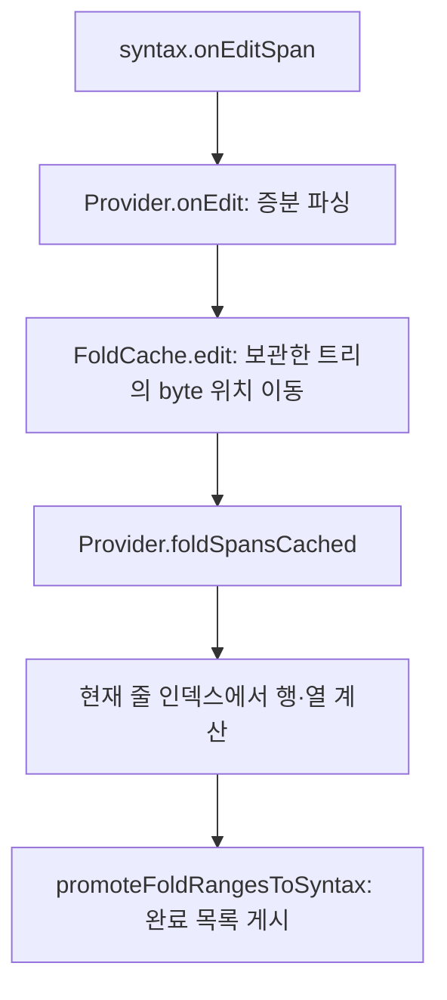

# EW2 제품 접힘 캐시

상태: 제품 경로 구현·자동 대조·실패 주입·함수 재실측 완료. 전면 AppKit 실측도 완료했으며 CI 확인은 대기 중이다.
사용자가 승인한 증분 갱신을 연결하며, 조용 시계나 새 접힘 UX는 도입하지 않는다.

## 책임과 소유

- `src/syntax/folds.zig`: byte 후보, 이전 트리 사본, 실제 편집과 구조 변경 범위의 갱신.
- `Provider.foldSpansCached`: 구문 트리와 문서 줄 인덱스를 같은 조회에 전달하고 방문량을 관측.
- `syntax.State`: 뷰별 캐시를 소유하고 편집 통지·전체 재파싱·해제와 함께 정산.
- `promoteFoldRangesToSyntax`: 완료된 목록만 기존 승격 경로에 전달. LSP의 우선권을 보존.



캐시는 allocator를 저장하지 않는다. 소유자가 조회·해제 때 같은 allocator를 전달한다.
이전 C 트리는 참조 사본 한 개를 보관하고 편집을 같은 순서로 적용한다. provider의 세대와 통지 수가
맞지 않으면 국소 갱신을 포기하고 현재 트리 전체에서 재구축한다. 캐시는 provider와 수명을 함께한다.
괄호·고정 헤더도 provider의 변경 정보를 소비하므로, 접힘은 보관한 트리와 현재 트리 사이의 범위를
독립적으로 구한다. `ts_tree_copy`는 참조 사본이며 문서 bytes나 줄 인덱스를 복사하지 않는다.

## 실구현에서 보강한 부분

기존 편집 통지의 삭제 전 끝 행은 시작 행으로 근사되어 있었다. 이 좌표로 후보 행을 이동하는
프로토타입을 그대로 연결하면 여러 줄 삭제 뒤 전체 순회와 다른 행이 나왔다.
캐시를 byte 범위로 바꾸고 문서가 이미 소유한 현재 줄 인덱스에서 행을 구하도록 수정했다.
문서 사본이나 별도 줄 인덱스는 추가하지 않는다. 후보 하나의 payload는 8 byte이며 배열 capacity,
C 트리 사본과 결과 배열은 별도 비용이다.
실제로 여러 줄인 후보만 저장한다. 한 줄짜리 노드만 있는 경우 후보 배열은 할당하지 않으며,
이후 줄바꿈 편집으로 여러 줄이 되면 실제 편집 범위에서 새 후보를 수집한다.

갱신 실패는 캐시와 불완전한 출력을 폐기해 다음 조회에서 전체 재구축한다. 기존 접힘·스크롤 상태는
승격 성공 전까지 보존한다. 처음 할당뿐 아니라 기존 캐시 성장 중의 모든 할당 위치도 실패시킨다.
LSP가 범위를 제공할 때 서버 범위는 그대로 두고 native 캐시도 유지한다. 다음 편집은 서버의 조용 시계 동안
구문 접힘으로 복귀하므로, 여기서 캐시를 버리면 입력 시작마다 전체 순회가 되풀이되기 때문이다.
빈 문서와 파싱 상한 밖의 문서는 더 이상 조회하지 않아도 트리 사본을 즉시 반환한다.

작은 주석 편집이 먼 선언을 드러내는 경우는 구조 변경 범위가 필요하다. 반대로 여러 줄 함수의 이름만
바꾸면 구조 변경 범위가 비어도 함수 머리 후보를 다시 수집해야 하므로 실제 편집 범위도 필요하다.
둘을 독립적으로 누락시켜 결과 대조가 검출하는지 확인한다.

## 검증과 재현

```sh
mise exec -- zig build test-editor-fold-cache test-editor-incremental-folds -j2
python3 tools/editor-fold-product/run.py --output /tmp/maru-fold-product --deps "$PWD/zig-pkg"
python3 tools/editor-fold-product/run.py --output /tmp/maru-fold-product --deps "$PWD/zig-pkg" --resume --run-only --verify-each-edit 1 --prefix verify --repetitions 1
python3 tools/editor-fold-measure/summarize.py /tmp/maru-fold-product --modes 2
python3 tools/editor-fold-measure/summarize.py /tmp/maru-fold-product --modes 2 --prefix verify --repetitions 1
python3 tools/editor-fold-product/review.py --output /tmp/maru-fold-review --deps "$PWD/zig-pkg"
python3 tools/editor-fold-measure/gui.py /tmp/maru-fold-product --output /tmp/maru-fold-gui --web-deps "$PWD/web/node_modules" --product --modes 0,1 --foreground
```

캐시 검증은 31개 언어, 무작위 편집 2,000회, 통지 누락·전체 교체·빈 문서·CRLF·native 트리 반환을 대조한다.
제품 검증은 실제 공유 분할의 여러 줄 삭제·붙여넣기·Undo/Redo, 파싱 중 편집과 승격 할당 실패를 포함한다.
큰 합성 문서에서 초기 구축 뒤 작은 편집의 트리 방문이 전체 크기의 십분의 일보다 작은지도 검사한다.

실측은 같은 제품 소스의 승격 호출만 전체 순회/캐시로 바꾼 두 사본을 교차 실행한다. 문서 5개·입력 8종·
방식 2개를 정확성 1회와 성능 3회로 분리한다. 이전 고정 원문은 `--fixtures <기존 fixtures>`로 재사용한다.
정확성 검사의 전체 순회로 다음 입력의 캐시가 덥혀지지 않게 실행을 분리한다. 원문·바이너리·제품 소스의
SHA-256, 키별 원시 시간과 캐시 capacity를 보존한다. AppKit 합성 입력과 Metal readback도 별도로 확인한다.

## 제품 함수 재실측

Apple M4 Max 16 logical CPU, RAM 64 GiB, macOS 26.5.1, Zig 0.17.0 ReleaseFast다.
일반 뷰는 800×600, 공유 뷰는 각각 400×600이다. test allocator를 사용하는 함수 경과시간이며
물리 입력→표시 지연이 아니다. 외부 시스템 부하를 통제하지 않고 두 방식을 교차 실행했다.

| 조건 | 전체 순회 p50 / p95 | 제품 캐시 p50 / p95 |
| --- | ---: | ---: |
| build.zig 일반 입력 | 15.05 / 15.47 ms | 9.30 / 9.66 ms |
| Swift 일반 입력 | 17.99 / 18.54 ms | 9.44 / 10.00 ms |
| build.zig 공유 두 뷰 | 27.26 / 28.28 ms | 15.88 / 17.38 ms |
| Swift 공유 두 뷰 | 32.99 / 35.01 ms | 15.53 / 18.21 ms |
| 3.13 MB Zig 일반 입력 | 94.68 / 98.39 ms | 49.06 / 50.32 ms |

정확성 80회는 모든 입력 단계와 최종 안정 상태에서 전체 순회와 불일치가 0이었다.
성능 240회는 마지막에만 대조해 다음 입력의 캐시를 덥히지 않았다.
일반 입력의 후보 backing 저장소는 build.zig 23,552 B, Swift 35,464 B, 큰 Zig 915,736 B였다.
공유 두 뷰의 저장소는 각각 두 배이며 C 트리·출력·임시 배열과 프로세스 RSS는 별도다.

공유 분할은 표시용 접힘 준비 뒤의 첫 입력을 포함한다. 새 뷰의 캐시는 첫 조회 때 전체 구축하므로
캐시 경로의 첫 입력 중앙값은 build.zig 25.20 ms, Swift 32.84 ms였다. 이후 입력의 중앙값은
15.86/15.49 ms다. 초기 구축까지 모두 국소 작업이라는 뜻은 아니다.
명시 접기 명령은 다른 비용이 커서 build.zig에서 95.85→90.22 ms에 그쳤다. 큰 문서와 명령의
전체 비용을 해결한 것으로 확대하지 않는다. 전체 조건은 [실측 결과표](../../tools/editor-fold-product/results.md)에 둔다.

로컬 증거는 `/Users/yoonhb/.cache/maru-agent-artifacts/editor-fold-product/`의 `inputs.json`,
`binaries.json`, `setup-*.json`, `hardware.json`, `summary.json`, `verify-summary.json`과 원시 로그다.
고정 바이너리·원문·제품 소스 해시를 기록하며, `before-final-state/`의 중간 자료는 최종 집계에서 제외한다.
최종 실패 주입은 `editor-fold-product-review-final/`에 원본 전후 대조군과 각 주입 로그·해시를 보존했다.

## AppKit 확인 상태

제품 빌드에 관측기만 주입한 실제 AppKit 합성 입력과 Metal readback을 별도로 검증한다.
잠금 상태의 12회/240개 입력에서 매 키의 누적 byte, 최종 전체 순회 일치와 원본 보존을 확인했다.
실제 960×600 Metal PNG도 확인했다. 로그·이벤트·이미지는 같은 artifacts 루트의
`editor-fold-product-gui-background/`, 바이너리 해시는 `editor-fold-product-gui/apps-final.json`에 둔다.
잠금 해제 뒤 같은 바이너리로 전면 12회/240개 입력도 검사했다. 매 키가 active/key window였고,
누적 byte 1~20, 최종 전체 순회 일치, 원문·바이너리 해시 보존을 모두 통과했다.
증거는 `editor-fold-product-gui-foreground/summary.json`과 실행별 이벤트·Metal PNG다.

| 입력 간격 | 전체 순회 처리 p50 / p95 | 캐시 처리 p50 / p95 | 전체 순회 예정→반환 p50 / p95 | 캐시 예정→반환 p50 / p95 |
| --- | ---: | ---: | ---: | ---: |
| 50 ms | 29.25 / 31.43 ms | 21.02 / 23.96 ms | 31.82 / 34.60 ms | 24.95 / 27.53 ms |
| 250 ms | 31.10 / 49.53 ms | 22.90 / 39.72 ms | 41.22 / 61.89 ms | 33.95 / 49.97 ms |

각 셀은 세 실행의 60개 이벤트를 합산한 중앙값과 nearest-rank p95다. 처리는 합성 `keyDown`부터
`renderTick` 반환까지이며 예정→반환에는 main queue 대기도 포함된다. 960×600 Swift 문서에서
공백 20개를 입력한 결과다. 잠금 상태 실행은 전면 지연으로 인용하지 않는다.
물리 HID나 compositor present 지연도 이번 실측의 증거가 아니다.

## 한계

트리 방문이 줄어도 후보 전체의 이동·정렬과 행 조회는 남는다. 분리된 구조 변경 범위가 여럿이면 후보
배열도 여러 차례 훑는다. 반복 비용은 후보 수·변경 범위 수·줄 수에도 의존한다.
전체 교체·초기 구축은 전체 순회이며, 모든 편집이 프레임 예산 안이라는 뜻은 아니다. 문서 복사와 줄 인덱스
재구축(EW3)도 남아 있다. GUI 합성 입력의 결과를 실제 IME·물리 HID·compositor present 지연으로 확대하지 않는다.
