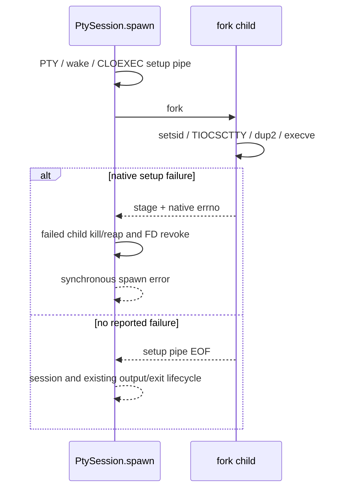

# macOS fork/exec 초기화 실패 전달

기존 `openpty → fork → setsid/TIOCSCTTY/dup2 → execve` 경로를 유지한다.
별도 helper나 native spawn 이관을 채택하지 않는다. 초기화 실패를 정상 세션처럼 반환하던 경계를 고친다.

## 실제 동작

부모는 stdio보다 높은 FD에 전용 pipe를 준비한다. 양 끝은 fork 전에 CLOEXEC이고 read end는
non-blocking이다. 자식은 read end를 닫고 초기화 실패 때만 고정 12바이트를 쓴 뒤 126/127로 종료한다.
자식에서는 errno를 먼저 저장하며 할당·로깅·잠금·formatting을 하지 않는다.

`spawnReporting`은 macOS backend의 동기 진단 sink로 검증된 실패의 stage/native errno/child PID를
돌려준다. `SpawnRequest`나 session-host RPC에 포인터/새 wire 필드를 넣지 않는다. 기본 `spawn`도 같은
경로를 사용하며 부모 쪽 로그에 stage/errno를 남긴다. 유효한 실패에서만 sink를 채우고 호출 시작에 비운다.

| 실패 단계 | spawn 오류 | 진단의 stage |
| --- | --- | --- |
| setsid | ChildSessionFailed | session |
| TIOCSCTTY | ChildTerminalFailed | terminal |
| dup2 | ChildStdioFailed | stdin / stdout / stderr |
| execve | ChildExecFailed | exec |

channel의 잘림·중복·잘못된 version/stage/reserved/errno는 `InvalidChildSetupStatus`다.
read/clock/lock 오류와 timeout/reap 실패는 별도 오류다. private wire는 `MPSE`, version1,
stage, reserved0 두 바이트, big-endian errno4바이트이며 그 길이와 의미는 `child_setup_status.zig`가 소유한다.

EOF는 exec나 셸 준비 완료의 증명이 아니다. 자식이 보고 없이 죽었거나 실제 target이 빨리 끝난 경우도
기존 세션의 exit lifecycle로 남긴다. 실제 target의 126/127을 초기화 실패로 재분류하지 않는다.
login wrapper를 사용할 때 이 채널의 exec 경계는 `/usr/bin/login`이다. 그 뒤 login이 수행하는 셸 실행의
실패는 기존 종료 이벤트다. 요청 cwd → HOME → 상속 cwd 폴백도 유지한다.

## 소유권과 기한

PTY spawn끼리는 setup pipe 생성부터 fork 및 부모 writer close까지만 pthread mutex로 직렬화한다.
다른 PTY 자식이 writer를 상속하면 정상 exec 뒤에도 EOF가 늦어질 수 있어서다. 부모는 writer를 닫고
바로 잠금을 풀어 자식 초기화·셸 실행·응답 대기는 병렬로 진행한다. 자식은 상속한 잠금을 건드리지 않는다.
다른 모듈의 모든 raw fork까지 직렬화하는 API는 아니며 전체 주변 FD 차단 정책을 추가하지 않는다.

fork 직전 monotonic 시계로 잡은 5초 기한을 poll/EINTR/부분 읽기에서 다시 시작하지 않는다.
이는 pre-exec 보고 구간의 보호 상한이며 사용자 셸 시작/ready 기한이나 성능 측정값이 아니다.
그 앞의 할당·terminfo·login 래핑과 mutex 대기, 동기 fork 자체의 중간 취소를 보장하지 않는다.

보고/채널 실패에는 독립 reader가 시작되기 전의 child 소유자가 회수를 수행한다. 이미 reap됐으면
다시 signal하지 않는다. 새 session이 확인된 경우만 group에 KILL하고 root PID도 종료시킨다.
기존 3초 bounded reap을 사용하고 끝내 회수되지 않으면 `ChildSetupReapFailed`를 반환한다.
모든 error 경로는 PTY/wake/setup FD를 닫는다. session instance/restore 직렬화 필드는 늘리지 않는다.

## 제품 검증

`test-pty-stdio`는 Debug·ReleaseFast 각각 **48개 조건**(실제 PTY45·입력 검증1·codec2)이다.
기존20개 stdio/tty/환경/입력/종료 검사를 유지하고 다음28개를 추가했다.

- pthread_atfork fixture로 실제 setsid/TIOCSCTTY/각 dup2 실패를 유발해 원래 errno와 stage를 받는다.
- 실제 없는 실행 파일·권한 없는 파일·잘못된 실행 형식과 닫힌 stdio에서 실패를 전달한다.
  실제 소비자가 쓰는 기본 `spawn`에서도 실패를 반환하고 부모 로그에 stage/errno를 남긴다.
- 잘못된 magic/version/stage/reserved/0·음수 errno, 잘린/중복/분할 프레임을 대조한다.
- child의 보고 없는0 종료와 target의 실제126/127 종료는 기존 exit 이벤트로 유지한다.
- 정지한 child의 timeout, stale 진단 지우기, codec의 길이 경계와 넓은 errno를 확인한다.
- 한 fork가 writer를 가진 채 정지하도록 하고 다른 정상 PTY가 먼저 완료되는지 확인한다.
  fork 전 100ms 겹침과 2.5초 정상 경계로 writer 결합을 구분하며 벤치마크로 세지 않는다.
- fixture의 별도 CLOEXEC PID pipe로 오류 child의 PID를 독립 관측해 ECHILD와 FD 반환을 단언한다.
  동시 진행 중인 전체 FD 수는 비교하지 않고 두 작업을 join한 뒤 비교한다.
- C target은 테스트 시작 전에 이미 열린 FD를 제외하고 새로운 PTY/status FD 누수를 검사한다.
  초기 fixture의 전체 FD=0 가정은 runner가 이미 물려준 FD1개를 잘못 분류해 실패했다.

격리 사본에서 writer 보호 lock과 두 unlock을 함께 제거하면 Debug·ReleaseFast 각각48개 중
동시 시작 조건만 실패했고47개는 통과했다. 같은 사본에 보호 코드를 복원하면 양쪽 모두48개가 통과했다.
앞선 lock만 제거하고 unlock을 남긴 대조는 잘못된 unlock의 영향을 배제할 수 없어 근거에서 제외했다.

기존 `test-pty`15개는 `/bin/sh`로 Debug/ReleaseFast를 검사한다. 사용자 dotfile이나 zsh 시작을
이 검증으로 대체하지 않는다. 정상 signed GUI/실제 사용자 셸 시작·모든 외부 raw fork 조합·
daemonized descendant 전체 회수·UI 오류 문구를 검증한 것으로 확대하지 않는다.

공개 근거는 설치 macOS SDK의 `fork`, `pipe`, `fcntl`, `write`, `poll`, `clock_gettime`, `waitpid`,
`getpgid`, `kill` 계약이다. 외부 터미널 소스 표현은 복사하지 않았다. 기존 helper PoC는 제품 의존성이 아니다.
