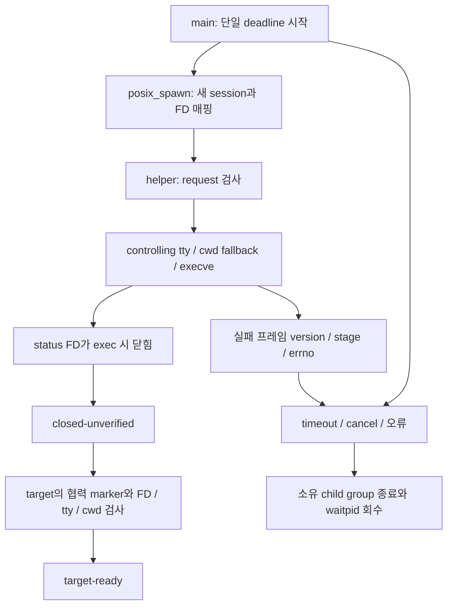

# PTY helper 초기화 실패 전달 PoC

[실제 셸 수명 검증](pty-helper-lifecycle.md)의 후속 독립 실험이다. 제품 `PtySession`·빌드·번들·서명 경로는
변경하지 않는다. 기존 모형이 126/127로만 접던 실패를 실제 native spawn과 PTY에서 구분한다.
이 문서의 wire는 실험 계약이며 제품 ABI로 확정하지 않는다.

## 실행과 상태 구분



부모는 표준 입출력의 PTY slave, request FD 3, status FD 4를 명시적으로 매핑한다.
원본 FD는 10 이상으로 옮겨 닫힌 stdio와 충돌하지 않게 한다. `POSIX_SPAWN_SETSID`와
`POSIX_SPAWN_CLOEXEC_DEFAULT`를 사용하고 signal mask를 비우며 SIGPIPE 기본 동작을 복원한다.
helper는 status FD에 CLOEXEC를 설정한 뒤 request를 검사하고 FD 3을 닫는다.
그 후 controlling tty 획득·작업 디렉터리/HOME 폴백·대상 exec를 수행한다.

| 관측 | 의미 |
| --- | --- |
| spawn-error | helper 실행 이전 native spawn의 반환 오류. 자식이 없으므로 가짜 reap을 기록하지 않는다. |
| helper-error | 정확히 한 개의 정상 실패 프레임과 EOF. stage와 원래 errno를 보존한다. |
| protocol-error | 잘린/추가/중복 프레임, 잘못된 magic/version/stage/reserved/errno. |
| closed-unverified | 실패 프레임 없는 EOF와 자식 종료. **준비 완료가 아니다.** |
| target-ready | EOF와 협력 target의 PID·FD·tty·session/foreground·cwd 조건을 확인한 별도 상태. |
| timeout / cancelled / read-error | 단일 deadline 또는 취소·I/O 실패. 자식 소유권을 보존해 회수한다. |

PID 반환, EOF, 종료 코드 0을 각각 readiness로 오인하지 않는다. helper가 0으로 즉시 끝난 경우와
실제로 exec한 target이 marker 없이 0으로 끝난 경우 모두 `closed-unverified`다.
협력 marker는 이 실험 target의 계약이다. 임의의 사용자 셸이 준비됐음을 증명하는 일반 프로토콜이 아니다.
status FD 자체가 닫히거나 설정에 실패하면 같은 FD로 오류를 보낼 수 없으므로 EOF/종료를 미확인으로 남긴다.

## Wire와 deadline

request는 `PHRQ` 4바이트, version=1, reserved 3바이트 0의 고정 8바이트다.
helper는 EOF까지 검사하여 잘림뿐 아니라 9번째 바이트도 거부한다. 부모가 write end를 닫지 않으면
유효한 8바이트를 받았어도 임의로 request 완료로 추정하지 않고 deadline으로 회수한다.
실행 경로와 cwd는 이 모형의 argv로 전달하며 가변 길이 요청/환경 직렬화는 검증하지 않는다.

실패 응답은 `PHER` 4바이트, version=1 1바이트, stage 1바이트, reserved 2바이트 0,
big-endian 양의 errno 4바이트의 고정 12바이트다. stage는 request=1, channel=2, tty=3, cwd=4, exec=5다.
채널 자체가 고장 난 경우 channel 프레임을 보낼 수 있다고 가정하지 않는다.
부모는 EOF까지 받아 길이가 정확히 12인지 확인하고, 0·음수로 해석되는 errno와 알 수 없는 stage를 거부한다.
읽기 버퍼는 25바이트로 제한하며 12바이트 초과 시 즉시 거부한다.

deadline은 준비 전에 시작하며 준비·spawn 반환·request/status·target 관측에 걸쳐 재시작하지 않는다.
부분 응답이나 EINTR도 기한을 연장하지 않는다. 동기 `posix_spawn` 자체를 중간에 취소하는 API는 아니다.
모형의 500ms는 실험값이며 제품 UX timeout 결정이 아니다. driver 외부 watchdog이 발동하면 실패로 보존한다.
그때 TERM handler는 소유한 SETSID child/group만 종료·회수한다. spawn/PID 등록과 waitpid/PID 해제 사이에는
TERM을 막아 이미 회수한 PID로 취소 경로가 뒤늦게 신호를 보내지 않게 한다.
임의의 daemonized descendant tree나 frozen host 수명 전체를 검증한 것으로 확대하지 않는다.

## 검증 집합

`init_status.py`는 C O0/O2 각각 **55개 서로 다른 계약**을 검사한다. 최적화 반복은 고유 조건 수가 아니다.

- 정상 실행·공백 cwd·HOME 폴백·준비 지연 정상 대조, stdio CLOEXEC와 닫힌 stdio 7조합.
- request의 version/magic/reserved/잘림/추가/빈 EOF/미완료 write end.
- status의 magic/version/stage/reserved/0 errno/음수 errno/잘림/추가/중복, 바이트별 정상 분할.
- 잘린 채 멈춤·정상 프레임 뒤 미완료 EOF·느린 trickle도 timeout까지 준비 완료로 오인하지 않음.
- 실제 비-TTY·cwd 양쪽 실패/HOME 없음·exec ENOENT/EACCES/ENOEXEC와 spawn ENOENT/EBADF.
- 실제 FD 소진, 준비 중 deadline 만료, helper/target 정지, 취소, 읽기 EBADF, 요청 쓰기 EBADF/EPIPE.
- helper 즉시 종료·signal 사망, target 무응답 42/0 종료, helper 0 종료, 실제 poll 중 signal.

비-TTY의 errno를 ENOTTY로 가정한 초기 fixture는 Darwin에서 ENODEV가 나와 거부됐다.
최종 검증은 독립 Python `fcntl.ioctl`의 같은 native 호출 결과와 비교한다. `/tmp`의 canonical path도
실제 cwd와 비교하도록 출력 경로를 resolve한다. 초기 자료는 최종 성공 집합과 분리해 보존한다.
성공 target은 request/status FD와 주변 FD가 남지 않는지, controlling tty·session·foreground·cwd를 확인한다.
실패/timeout도 root reap과 process group 소멸을 검사한다. 정상 앱 종료·UI·실제 셸의 준비 상태 검증은 아니다.

`init_status_controls.py`는 소유한 소스 사본만 바꿔 EOF=ready 오판·status FD 누수·request FD 누수·
version 검사 생략·native errno 변조·준비 후 deadline 재시작의 **6개 결함**을 각각 컴파일한 뒤 행동 검증에서 거부한다.
원본과 바이트별 request 전송의 동등 대조는 전체 계약을 유지한다. 컴파일 실패는 변이 검출로 세지 않는다.

## 재현

```sh
python3 tools/pty-spawn-poc/init_status.py --output /tmp/maru-init-status-new
python3 tools/pty-spawn-poc/init_status_controls.py --output /tmp/maru-init-controls-new
```

macOS SDK·C compiler·Python 표준 라이브러리만 사용한다. 기본 CI/제품 빌드에는 넣지 않는다.
출력은 새 경로여야 하며 원문·소스/실행 파일·compiler/SDK/Git 지문·불완전 progress를 보존한다.
성공 집합만 `results.json`을 게시한다. `python3 -O`에서도 독립 require 판정은 유지된다.

## 남은 제품 적용 조건

서명된 GUI/CLI/frozen-host의 진입점 선택, 경로 고정·업데이트 수명, 실제 `PtySession`의 tty/cwd/login/
foreground·동시 spawn·signal 상속·취소 계약과 제품 오류 상태 전이는 여전히 별도 작업이다.
이 PoC로 helper 배치 방식이나 readiness ABI를 채택했다고 주장하지 않는다.
공개 근거는 설치 macOS SDK의 `spawn.h`, `fcntl.h`, `sys/wait.h`, `poll.h`, `sys/ioctl.h`와
[Apple posix_spawn](https://developer.apple.com/library/archive/documentation/System/Conceptual/ManPages_iPhoneOS/man2/posix_spawn.2.html)이다.
외부 구현 소스는 사용하지 않았다.
