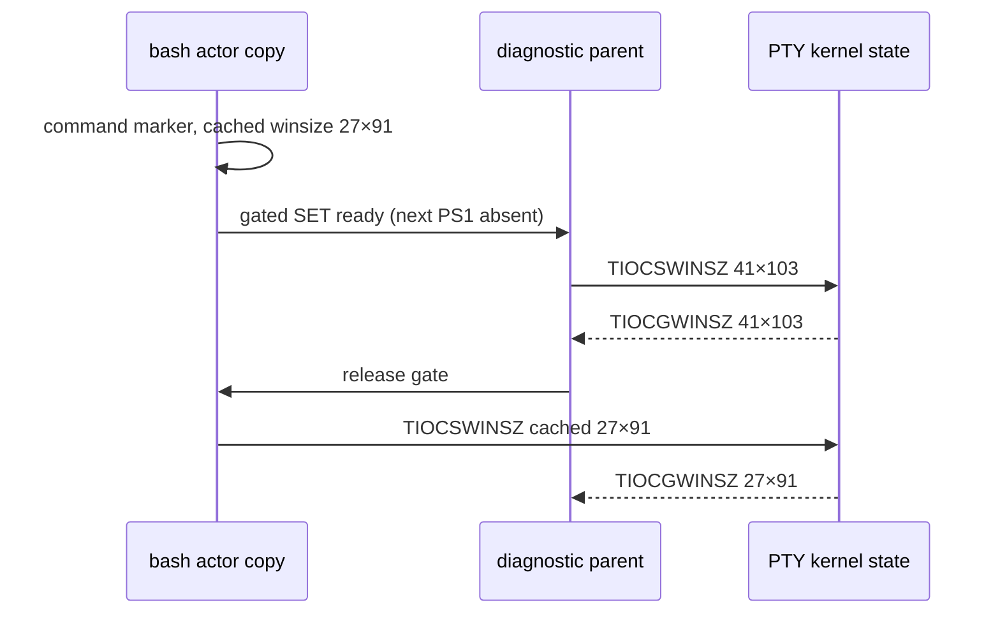

# PTY 크기 재기록의 인과 대조

[실제 셸 수명 PoC](pty-helper-lifecycle.md)에서 보존한 27×91 재관측의 후속 조사다.
2026-11-06, macOS 26.5.1 arm64·clang 17·SDK 26.2에서 수행했다.
제품 `PtySession`·렌더러·geometry 정책은 변경하지 않는다.

## 확인한 메커니즘

독립 PTY에서 **bash 프로세스 자신이 이전 winsize를 TIOCSWINSZ로 다시 쓰는 것**을 관측했다.
명령의 출력 marker 이후, 다음 PS1이 나오기 전의 SET 호출을 gate로 잡아 다음 순서를 선택했다.
세 대조를 fork와 native helper 양쪽에서 확인했다.

| 스케줄 | 실제 syscall 순서/행동 | 최종 rows×cols |
| --- | --- | --- |
| stale | 부모 SET 41×103 성공 → bash의 캐시된 SET 27×91 성공 | 27×91 |
| after | bash SET 27×91 완료 → 다음 프롬프트 → 부모 SET 41×103 성공 | 41×103 |
| drop-stale | 부모 SET 41×103 성공 → 진단용 interposer가 그 오래된 쓰기 1개만 억제 | 41×103 |

부모 ioctl 직후 41×103인 것과, gated actor 쓰기 뒤 27×91인 것을 각각 커널에서 읽었다.
actor PID·gate PID·parent PID·성공 rc·작성 값·같은 append 로그의 순서를 함께 검사한다.
부모/actor의 서로 다른 clock 값을 이어 붙여 순서를 추정하지 않는다.
helper도 같은 결과이므로 **프로세스 생성 방식을 native로 바꾸는 것만으로 이 후속 쓰기를 제거할 수 없다.**

## 계측 범위와 한계

이 진단은 bash/stty의 **소유한 임시 사본**만 ad-hoc 재서명하고 독립 ioctl interposer를 읽힌다.
설치된 `/bin/bash`·`/bin/stty`는 읽기 전용이며 앞뒤 파일 hash를 확인한다.
서명으로 바뀔 수 있는 header/LINKEDIT와 실행 코드를 구분해, otool의 `__TEXT,__text` 데이터를
정규화한 fingerprint도 원본/사본이 같은지 확인한다. 이 최초 syscall 대조는 외부 구현 소스나
역어셈블을 읽지 않았다. 아래 후속 원인 조사는 Apple 공개 셸 소스와 설치 bash의 호출 위치를 대조했다.

일반 재실행 40회에서는 재현되지 않았지만 이를 수리 증거로 세지 않는다. 수동 trace도 syscall 간격을
바꾸므로 재현율·제품 발생률·성능 측정에 쓰지 않는다. gate로 순서를 선택한 대조가 인과 증거다.
arm64만 포함한 초기 라이브러리는 arm64e actor에서 거절돼 그 기동 실패군을 모두 제외했다.
최종 라이브러리는 두 architecture를 포함하며 완전한 3스케줄 기록만 성공 결과로 게시한다.

최초 미계측 1건에는 writer trace가 없으므로 그 1건의 writer를 소급해 단정하지 않는다.
이번에 확인한 것은 같은 크기 되돌림을 일으키는 **구체적인 writer와 순서**다.
Maru GUI/렌더러 없이 재현되지만 제품 발생률·유일 원인·모든 OS 호환성을 증명하지 않는다.
다음 실제 제품 검증에서는 UI 요청 geometry, 실제 PTY 크기, 자식의 재기록을 구분해 관측한다.
이 관측만으로 앱이 자식의 의도적인 stty 변경을 항상 덮어쓰는 정책을 도입하지 않는다.

`drop-stale`은 **진단용 반사실**이며 이용자 셸에 넣을 수정이 아니다.
현재 fixture는 명령 marker와 다음 PS1을 구분하지만 임의의 모든 readline 전환을 검증했다고 주장하지 않는다.
zsh system-init 간섭군, signed app/frozen-host, 초기화 오류 채널은 여전히 별도 미검증 범위다.

## 계측기 자체의 대조

gate 파일 조회가 성공한 ioctl 뒤의 errno에 섞이는 초기 관측기 결함도 별도 프로그램으로 확인했다.
같은 작은 소유 프로그램의 GET/SET 성공·잘못된 FD 실패를 계측 전후 비교했다.
관측기는 진입 errno를 native 호출 전에 복원하고, logging 뒤에는 native 결과의 errno를 복원한다.
그 수정 뒤에도 세 인과 스케줄이 유지되는지 재검증한다. 성공 errno의 표준값을 가정하는 대신 같은 host의
관측기 없는 프로그램 출력과 비교하며, 그 일치가 확인돼야 study를 수행한다.
초기 관측기 자료는 이 투명성 검사를 갖춘 최종 cohort와 구분한다.

## 재현과 검증

[도구 명령](../../tools/pty-spawn-poc/README.md)의 `resize_study.py`와 `resize_review.py`를 사용한다.
3스케줄씩 두 backend에서 관측한다. 이 mode 반복을 독립 조건 수로 부풀리지 않는다.
실측 자료의 writer/rc/순서/크기/실행 코드 fingerprint·완료/reap/timeout을 독립적으로 손상시키는
33개 가설은 거부하고, 스케줄 직렬화 순서만 바꾼 동등 대조군과 원본은 유지한다.
검증은 Python `-O`에서도 생략되지 않는다. 기존 실제 bash 20조건과 집중 변이도 다시 확인한다.
원문·사본 actor·라이브러리·소스·structured 결과는 로컬 artifact로만 보존한다. 바이너리 사본은 git에 넣지 않는다.

공개 API 근거는 Apple [동적 라이브러리 사용/함수 interposition](https://developer.apple.com/library/archive/documentation/DeveloperTools/Conceptual/DynamicLibraries/100-Articles/UsingDynamicLibraries.html),
설치 SDK의 `sys/ioctl.h`·`sys/ioccom.h`와 `winsize`다. trace/반실험은 제품 native helper의 서명/admission 증거를 대체하지 않는다.

## 후속 원인과 실제 앱 비교 — 2026-11-07~08

설치된 macOS bash 3.2.57의 Readline은 tty 설정을 조회하기 전에 현재 winsize를 읽고 같은 값을
다시 쓴다. 백그라운드 readline의 tty 접근을 제어하려는 처리이며, 두 syscall 사이에 앱의 resize가
끼면 직전에 읽은 로컬 값이 최신 크기를 덮어쓴다. 영구 설정 캐시가 아니다.
Apple [Readline 경로](https://github.com/apple-oss-distributions/bash/blob/51bf3fc6f26e9517c3a2e4bc3d208f9b39b87178/bash-3.2/lib/readline/rltty.c#L140-L153)와
설치 bash의 read-only disassembly·소유한 사본의 backtrace를 대조했다. 외부 코드를 제품에 복사하지 않았다.

실제 Maru in-process 앱에서 38→30열 적용 뒤 bash SET를 재개하자 model은 30열, kernel은 38열이었다.
반대 순서는 30열로 일치했다. SET를 재개하기 전에 bash의 SIGWINCH 수신 표시가 0→1로 변한 것도
확인했다. 따라서 신호 유실로 분류하거나 내부 mutex·native spawn만으로 해결됐다고 주장하지 않는다.

| 후속 조건 | 관측과 범위 |
| --- | --- |
| 공식 Ghostty 1.4.0 + 계측한 bash 사본 | 실제 창을 줄여 PTY 119→99열 적용 뒤 bash SET를 재개하면 119열로 회귀. 순서를 반대로 하면 99열 유지. 창 너비와 kernel을 관측했으며 Ghostty 내부 화면 모델·픽셀 깨짐은 미검증. |
| 시스템 zsh 5.9 독립 PTY | fork/helper 각 1,000회와 resize 없는 1,000회에서 snapshot 불일치 미관측. 일반 크기 갱신 경로의 SET는 Apple 공개 소스에서도 주석 처리되어 있다. |
| 실제 Maru + 시스템 bash/zsh | syscall 계측·gate 없이 각 200명령의 실행 확인과 AX resize 100회. 변경 후 관측한 PTY 크기는 예상 치수와 일치했고 전후 model/kernel도 일치했다. |
| Maru 긴 ASCII 명령 | 두 셸 모두 208자 입력 후 95열 줄바꿈의 예상 cursor 32열과 실제값이 일치. native Metal PNG와 실행 결과의 정확한 문자열을 확인했다. |

zsh 근거는 Apple [일반 크기 갱신 경로](https://github.com/apple-oss-distributions/zsh/blob/666e91a595af505ef61d5f9b87df7a014a4937c6/zsh/Src/utils.c#L1871-L1934)다.
zpty의 새 PTY 생성 경로와 모든 사용자 설정까지 같은 성질이라고 일반화하지 않는다.
시스템 초기화 파일 간섭은 시험 자식에만 sandbox-exec 읽기 거부를 적용해 분리했다.
시스템 셸·초기화 파일은 수정하지 않았다. 이는 무격리 사용자 설정 전체의 검증이 아니다.
앱 입력은 대상 PID CGEvent와 AX 창 변경이며 실제 HID/IME 검증으로 세지 않는다.

명령 확인 없이 빠르게 주입한 초기 집합은 키 합침/누락으로 완전한 입력 성공 자료에서 제외했다.
최종 집합은 명령별 실행 확인을 기다렸다. 외부 창 캡처 실패와 native capture 허용 환경 누락도
따로 보존했고, Maru의 최종 PNG는 기존 허용 환경으로 얻었다. 관측 불일치 0회는 경쟁의 불가능성이나
제품 수리를 증명하지 않는다. 초기화 오류 채널·session-host·사용자 설정·다른 OS 범위는 여전히 남는다.

로컬 원문은 `~/Documents/maru-validation/pty-resize-app-20261107/root-cause.md`와
`~/Documents/maru-validation/pty-shell-comparison-20261108/README.md` 및 `accepted-summary.json`에 보존한다.
설치 사본·진단 바이너리·사용자 경로가 포함된 원문은 공개 fixture로 올리지 않는다.

## 채택한 처리 방향

사용자 논의(2026-11-08)에 따라 **macOS bash 3.2 호환성 문제로 범위를 좁혀 관리**한다.
전체 셸에 주기적 크기 재적용이나 자식의 의도적인 stty 변경을 덮어쓰는 정책은 추가하지 않는다.
제품 runtime 변경은 보류한다. 기본 zsh와 이번 자연 입력 집합에서 미관측인 결과를 bash 문제의
해결 증거로 사용하지 않는다. 후속 수정은 실제 제품 영향과 셸별 범위를 검증한 뒤 별도로 결정한다.
