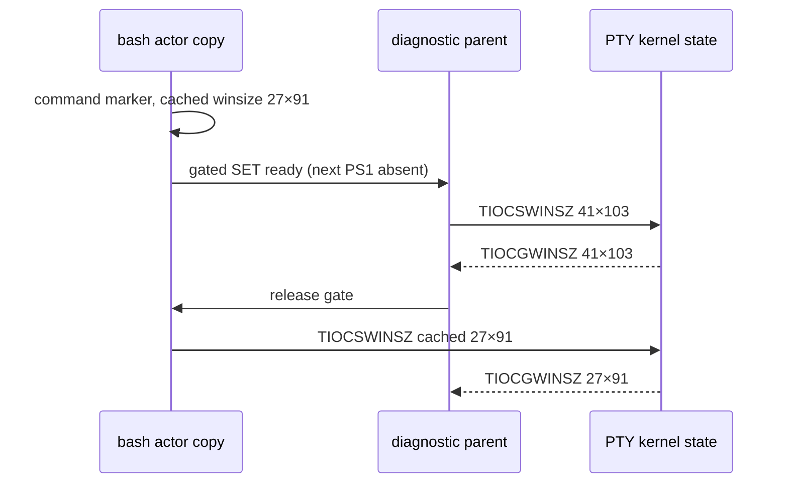

# PTY 크기 재기록의 인과 대조

[실제 셸 수명 PoC](pty-helper-lifecycle.md)에서 보존한 27×91 재관측의 후속 조사다.
2026-11-06, macOS 26.5.1 arm64·clang 17·SDK 26.2에서 수행했다.
제품 `PtySession`·렌더러·geometry 정책은 변경하지 않는다.

## 확인한 메커니즘

독립 PTY에서 **bash 프로세스 자신이 이전 winsize를 TIOCSWINSZ로 다시 쓰는 것**을 관측했다.
명령의 출력 marker 이후, 다음 PS1이 나오기 전의 SET 호출을 gate로 잡아 다음 순서를 선택했다.
세 대조를 fork와 native helper 양쪽에서 확인했다.

| 스케줄 | 실제 syscall 순서/행동 | 최종 rows×cols |
| --- | --- | --- |
| stale | 부모 SET 41×103 성공 → bash의 캐시된 SET 27×91 성공 | 27×91 |
| after | bash SET 27×91 완료 → 다음 프롬프트 → 부모 SET 41×103 성공 | 41×103 |
| drop-stale | 부모 SET 41×103 성공 → 진단용 interposer가 그 오래된 쓰기 1개만 억제 | 41×103 |

부모 ioctl 직후 41×103인 것과, gated actor 쓰기 뒤 27×91인 것을 각각 커널에서 읽었다.
actor PID·gate PID·parent PID·성공 rc·작성 값·같은 append 로그의 순서를 함께 검사한다.
부모/actor의 서로 다른 clock 값을 이어 붙여 순서를 추정하지 않는다.
helper도 같은 결과이므로 **프로세스 생성 방식을 native로 바꾸는 것만으로 이 후속 쓰기를 제거할 수 없다.**

## 계측 범위와 한계

이 진단은 bash/stty의 **소유한 임시 사본**만 ad-hoc 재서명하고 독립 ioctl interposer를 읽힌다.
설치된 `/bin/bash`·`/bin/stty`는 읽기 전용이며 앞뒤 파일 hash를 확인한다.
서명으로 바뀔 수 있는 header/LINKEDIT와 실행 코드를 구분해, otool의 `__TEXT,__text` 데이터를
정규화한 fingerprint도 원본/사본이 같은지 확인한다. 외부 구현 소스나 역어셈블은 읽지 않는다.

일반 재실행 40회에서는 재현되지 않았지만 이를 수리 증거로 세지 않는다. 수동 trace도 syscall 간격을
바꾸므로 재현율·제품 발생률·성능 측정에 쓰지 않는다. gate로 순서를 선택한 대조가 인과 증거다.
arm64만 포함한 초기 라이브러리는 arm64e actor에서 거절돼 그 기동 실패군을 모두 제외했다.
최종 라이브러리는 두 architecture를 포함하며 완전한 3스케줄 기록만 성공 결과로 게시한다.

최초 미계측 1건에는 writer trace가 없으므로 그 1건의 writer를 소급해 단정하지 않는다.
이번에 확인한 것은 같은 크기 되돌림을 일으키는 **구체적인 writer와 순서**다.
Maru GUI/렌더러 없이 재현되지만 제품 발생률·유일 원인·모든 OS 호환성을 증명하지 않는다.
다음 실제 제품 검증에서는 UI 요청 geometry, 실제 PTY 크기, 자식의 재기록을 구분해 관측한다.
이 관측만으로 앱이 자식의 의도적인 stty 변경을 항상 덮어쓰는 정책을 도입하지 않는다.

`drop-stale`은 **진단용 반사실**이며 이용자 셸에 넣을 수정이 아니다.
현재 fixture는 명령 marker와 다음 PS1을 구분하지만 임의의 모든 readline 전환을 검증했다고 주장하지 않는다.
zsh system-init 간섭군, signed app/frozen-host, 초기화 오류 채널은 여전히 별도 미검증 범위다.

## 계측기 자체의 대조

gate 파일 조회가 성공한 ioctl 뒤의 errno에 섞이는 초기 관측기 결함도 별도 프로그램으로 확인했다.
같은 작은 소유 프로그램의 GET/SET 성공·잘못된 FD 실패를 계측 전후 비교했다.
관측기는 진입 errno를 native 호출 전에 복원하고, logging 뒤에는 native 결과의 errno를 복원한다.
그 수정 뒤에도 세 인과 스케줄이 유지되는지 재검증한다. 성공 errno의 표준값을 가정하는 대신 같은 host의
관측기 없는 프로그램 출력과 비교하며, 그 일치가 확인돼야 study를 수행한다.
초기 관측기 자료는 이 투명성 검사를 갖춘 최종 cohort와 구분한다.

## 재현과 검증

[도구 명령](../../tools/pty-spawn-poc/README.md)의 `resize_study.py`와 `resize_review.py`를 사용한다.
3스케줄씩 두 backend에서 관측한다. 이 mode 반복을 독립 조건 수로 부풀리지 않는다.
실측 자료의 writer/rc/순서/크기/실행 코드 fingerprint·완료/reap/timeout을 독립적으로 손상시키는
33개 가설은 거부하고, 스케줄 직렬화 순서만 바꾼 동등 대조군과 원본은 유지한다.
검증은 Python `-O`에서도 생략되지 않는다. 기존 실제 bash 20조건과 집중 변이도 다시 확인한다.
원문·사본 actor·라이브러리·소스·structured 결과는 로컬 artifact로만 보존한다. 바이너리 사본은 git에 넣지 않는다.

공개 API 근거는 Apple [동적 라이브러리 사용/함수 interposition](https://developer.apple.com/library/archive/documentation/DeveloperTools/Conceptual/DynamicLibraries/100-Articles/UsingDynamicLibraries.html),
설치 SDK의 `sys/ioctl.h`·`sys/ioccom.h`와 `winsize`다. trace/반실험은 제품 native helper의 서명/admission 증거를 대체하지 않는다.
